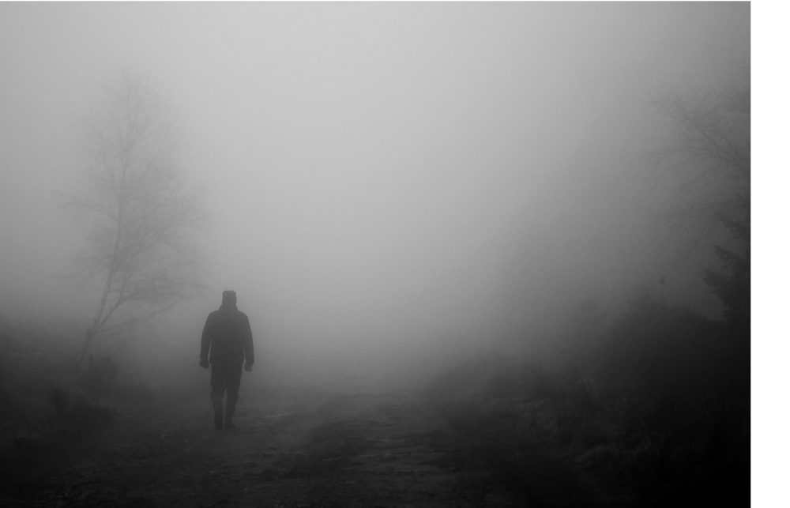

Вечный берег не щадит человеческую психику. Из-за вездесущего тумана, странного окружения и неотвязного ощущения «чуждости» каждый персонаж, впервые попавший в это странное царство, должен пройти **проверку Рассудка** (потеря 0/1d4 Рассудка). Попадание на Вечный берег может дать и понимание Мифов: персонажи, впервые попавшие в это измерение, также получают +2% к навыку **Мифы Ктулху**.

Попасть на Вечный берег легко, а выбраться гораздо труднее. Чтобы найти дорогу обратно в реальный мир, персонаж должен пройти проверку **Ориентирования** или **Оккультизма**. Успех означает, что он нашёл путь обратно в реальность, а провал — что он заблудился и должен бродить по туманному царству, пока не сориентируется. Заблудиться — мучительное переживание, и каждый такой сыщик должен пройти **проверку Рассудка** (потеря 0/1d2 Рассудка).

Последняя и самая большая опасность Вечного берега — существа, для которых он дом. Этих тощих кошмарных тварей тянет к каждому, кто попадает в их дом, и они выслеживают и убивают всех, кого найдут. Чем дольше сыщик остаётся на Вечном берегу, тем вероятнее он столкнётся с троглодитом или группой порабощённых жителей.

### Район 1. Главная дорога

Главная дорога — так называется единственная дорога, которая связывает Портхоллоу с внешним шоссе. Она спускается под гору к побережью, вдоль неё стоят живописные дома. Единственное сколько-нибудь интересное здание в этом районе — деревенский магазин.

#### Деревенский магазин

Небольшой магазин с квартирой над ним. Дверь магазина качается на ветру, а внутри жутко пусто. На полках — еда, немного медицинских припасов и разные хозяйственные мелочи. Зоркие сыщики, возможно, заметят признаки того, что кто-то уже брал с полок еду и другие вещи, а проверка **Чтения следов** обнаружит следы, ведущие сыщиков к выжившим, которые прячутся в пабе.

### Район 2. Деревенский луг

Центр деревни устроен вокруг маленького луга с декоративными клумбами и деревянными скамейками. Теперь луг заполнен туманом, зловеще клубящимся вокруг домов. Здесь два примечательных здания — паб и деревенский клуб.

#### Паб «Ромовоз»

Большое двухэтажное здание с вывеской «Ромовоз» (*The Rumrunner*). Парадные двери заколочены изнутри, а боковая дверь загорожена несколькими предметами тяжёлой мебели. Внутри — шестеро выживших, которым до сих пор удавалось избегать нападений троглодитов и порабощённых жителей.

Хранителю советуем привести сыщиков к пабу или как-то иначе свести их с выжившими внутри. Например, сыщики могут сильно нашуметь (скажем, сигналить или кричать) или столкнуться с группой порабощённых жителей и бежать от них. В любом случае может появиться Чарльз Дуглас и отвести сыщиков в безопасное место — в паб.
