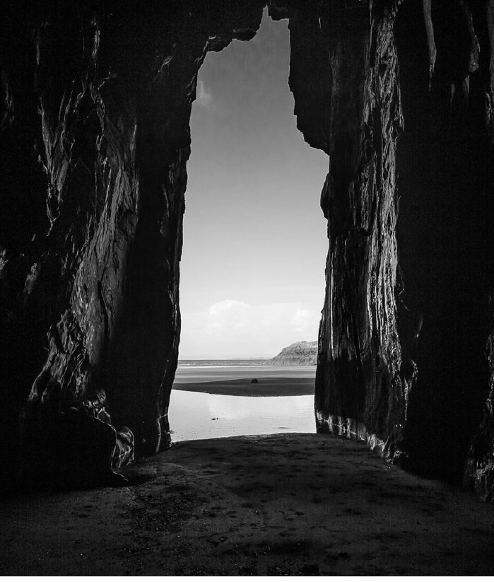

Тропа около 800 м поднимается в гору к сухопутному входу в пещеры. У входа в пещеры ещё одна табличка предупреждает об опасности внутри, а деревянные заграждения будто бы перекрывают вход. Однако перелезть через них совсем нетрудно. Отсюда путь ведёт в **пещеры в утёсах**.

### Пещеры в утёсах

Пещеры — запутанная сеть соединённых между собой туннелей, которые пронизывают утёсы и спускаются к большому морскому гроту у их подножия. Уже несколько десятилетий пещеры закрыты, и сюда заходят только местные подростки — выпить и отдохнуть (зоркие сыщики могут заметить следы этого). Недавно Дэниел и Андреа несколько дней подряд приходили сюда каждый день в поисках входа в туннели. Разгадав секрет карты Макгаффри, они сумели открыть дверь в туннели и проникнуть внутрь.

Теперь пещеры пусты, но из-за близости идола и его растущей силы они находятся на самой грани Вечного берега. В отличие от остального Портхоллоу, в пещерах нет липкого тумана. Однако на краю поля зрения сыщиков движутся тени, стены время от времени словно превращаются из бледного известняка в тёмно-зелёный камень, покрытый странными рунами, а из боковых туннелей эхом доносится призрачный шёпот. Из-за всего этого путь по туннелям сбивает с толку и тревожит. Впервые попав в пещеры, сыщики должны пройти **проверку Рассудка** (потеря 0/1d2 Рассудка).

В пещерах совершенно темно, так что сыщикам понадобится какой-нибудь источник света, чтобы находить дорогу. Пещеры к тому же извилисты и запутанны, так что если у сыщиков нет карты (её можно найти в коттедже Дэниела в деревне, в сувенирной лавке или в интернете), им придётся проходить проверки **Ориентирования**, чтобы не заблудиться.

Основная часть пещер — сеть небольших извилистых туннелей в известняковых утёсах, которые порой заканчиваются маленькими тупиками. Тут и там видны следы разных попыток найти легендарное сокровище: старые следы взрывов, брошенные ржавые инструменты, обвалившиеся разведочные ходы.

На самом деле вход в туннели Харботтла спрятан в самой нижней части пещер, в большом морском гроте. Здесь сыщики заметят разбросанные недавно прогоревшие светящиеся палочки (их оставили Дэниел и Андреа) и несколько странных знаков, вырезанных на каменных стенах.

Знаки высекли в известняке века назад Пит Харботтл и его команда. Большинство из них — ложные следы, расставленные по пещере, чтобы запутать незадачливых кладоискателей. Знак, отмечающий вход в потайные туннели, нанесён на карту Макгаффри симпатическими чернилами (а также перерисован в дневник Андреа). Не зная правильного знака, сыщики должны пройти чрезвычайную проверку **Внимания**, чтобы заметить, что два знака повторяются; это и есть настоящие знаки. Из двух тот, что ближе к кромке воды (и в прилив уходит под воду), отмечает потайную дверь.

Открыть потайную дверь достаточно просто: это участок стены пещеры с хитроумным противовесом, так что его можно открыть, толкнув с минимальным усилием (надо лишь знать, куда толкать). Важно помнить, что из-за давления морской воды дверь открывается только в отлив.

Открывшись, дверь поворачивается внутрь, и за ней виден тёмный проход, ведущий в **туннели Харботтла**.

### Туннели Харботтла

В туннелях Харботтл и его люди прятали добычу, нажитую пиратским промыслом. Хотя туннели начинались как естественные пещеры, в залах видны следы тщательной работы — их вырубали, чтобы сделать пригоднее для жизни. Однако время взяло своё, и теперь в залах сыро, холодно и капает вода.

В туннелях так же темно, как и в остальных пещерах, но Дэниел и Андреа оставили повсюду десятки промышленных светящихся палочек, которые до сих пор испускают бледно-зелёный свет. Его хватает, чтобы видеть, пусть и без подробностей. Благоразумные сыщики могут использовать палочки и как ориентиры.

Туннели не слишком обширны, поэтому ниже описан каждый зал по отдельности.

> **Как снизить сложность**
>
> Харботтл и его команда снабдили потайные туннели несколькими смертельными ловушками, чтобы защитить сокровище от воров. Одна из ловушек обезврежена, но две другие по-прежнему на месте.
>
> Ловушки в туннелях добавлены, чтобы дать игрокам опасности окружающей среды, а не только сверхъестественные, — и ещё потому, что пиратские туннели с ловушками — хороший штамп. Однако потерять персонажа из-за одной неудачной проверки навыка бывает обидно, так что Хранитель может решить, что оставшиеся ловушки (в зале-ловушке и камнепад) либо обезвредил Реддингтон или Дэниел с Андреа, либо они попросту развалились за 300 с лишним лет, прошедших с их постройки.
