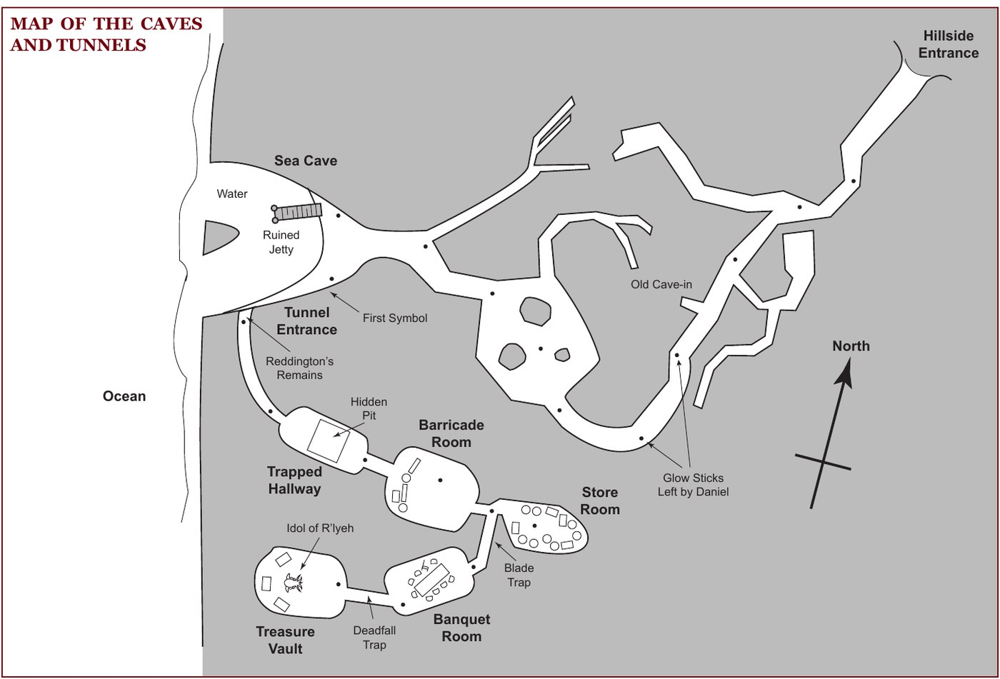

#### Вход в туннели

Войдя в туннели, сыщики почти сразу же обнаружат у стены сразу за дверью иссохший, наполовину мумифицированный труп — бренные останки Реддингтона Уолтон-Брауна.

Уже при беглом осмотре совершенно очевидно, что тело пролежало здесь десятилетия и что очень солёный воздух пещер отчасти его сохранил. Ясно, что это мужчина, а в бумажнике (он всё ещё в кармане) найдутся водительские права Реддингтона Уолтон-Брауна. Рядом с ним лежит большой рюкзак, а в иссохших руках мертвец держит листок бумаги. Поскольку труп очень старый, проверка Рассудка за его обнаружение не нужна — разве что Хранитель настроен особенно садистски.

Успешная проверка **Медицины** подтвердит, что трупу почти 40 лет и что ран на нём, по-видимому, нет; скорее всего, Реддингтон умер от какой-то передозировки или от яда (на самом деле он покончил с собой, приняв слишком много барбитуратов, запитых виски, — всё это было у него с собой).

Если сыщики возьмут листок бумаги, дайте им раздатку 13. Эта записка раскрывает, что Реддингтон нашёл глубже в туннелях и почему решил покончить с собой.

В рюкзаке Реддингтона — кое-какие инструменты, моток верёвки, заплесневелый паёк, восемь шашек динамита, капсюль-детонатор, катушка провода и подрывная машинка. Несмотря на возраст, динамит и капсюль-детонатор всё ещё пригодны.

Дверь в туннели легко закрывается и открывается изнутри, так что игроки могут запечатать её за собой, чтобы не пустить внутрь морскую воду.

#### Зал-ловушка

Этот широкий зал на самом деле ловушка: большой участок в центре зала — глубокая яма, утыканная заострёнными деревянными кольями и прикрытая тонким слоем хрупких сланцевых плиток. Каждый, кто ступит на середину зала, провалится вниз, на колья. Пересечь зал можно, держась поближе к любой из стен, где пол прочен на полосе шириной около 30 см.

Дэниел и Андреа, у которых была карта Макгаффри, благополучно прошли этот зал, но не оставили никаких указаний, как именно. Когда сыщики войдут в зал, они должны пройти проверку **Внимания**; при успехе они замечают, что в свете их фонарей середина зала кажется странно гладкой. Если они пройдут проверку с трудным успехом (не больше половины навыка), Хранителю следует прямо сказать им, что зал — ловушка.

Если сыщик всё же провалится сквозь пол, он рухнет на колья. Он должен пройти проверку **Уклонения**, чтобы не напороться на них; при успехе он получает 1d4 урона от падения. При провале он вдобавок насаживается на кол и вместо этого получает 1d6 урона.

Хранитель может внимательно следить, кто входит в зал первым, и в ловушку должен падать персонаж, идущий впереди, а не вся группа разом.

#### Зал с баррикадой

Большую часть этого зала занимает большой деревянный частокол, который люди Харботтла построили на случай, если им когда-нибудь понадобится оборонять пещеры. На частоколе стоит маленькая пушка-«полукулеврина», нацеленная на входящих сыщиков, — теперь ржавая и бесполезная.

## Карта пещер и туннелей

*Подписи на карте: Вход со склона (Hillside Entrance); Морской грот (Sea Cave); Вода (Water); Разрушенный причал (Ruined Jetty); Старый обвал (Old Cave-in); Вход в туннели (Tunnel Entrance); Первый знак (First Symbol); Останки Реддингтона (Reddington’s Remains); Океан (Ocean); Скрытая яма (Hidden Pit); Зал с баррикадой (Barricade Room); Зал-ловушка (Trapped Hallway); Кладовая (Store Room); Светящиеся палочки, оставленные Дэниелом (Glow Sticks Left by Daniel); Идол Р’льеха (Idol of R’lyeh); Ловушка с лезвиями (Blade Trap); Пиршественный зал (Banquet Room); Ловушка с камнепадом (Deadfall Trap); Сокровищница (Treasure Vault); стрелка «Север» (North).*
