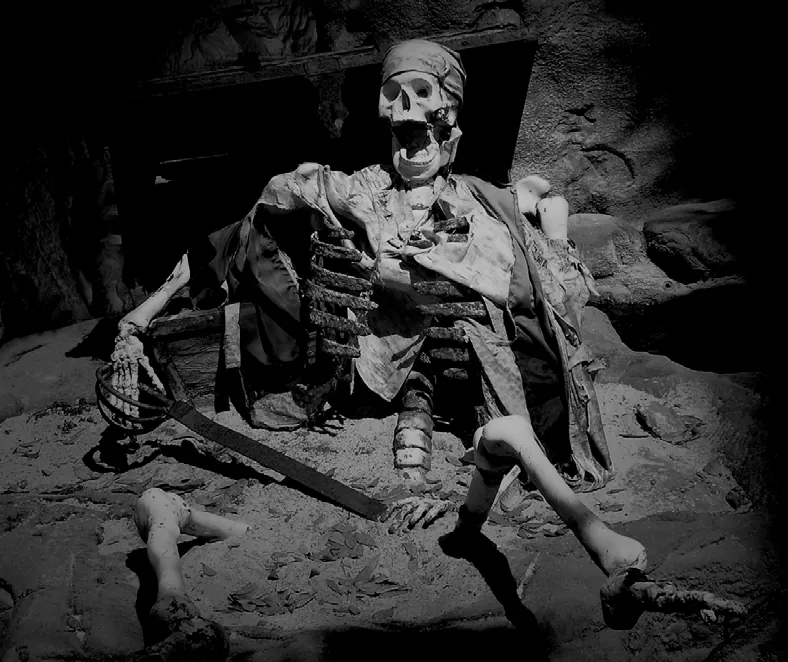

Не считая нескольких старых бочек, бухт гнилой верёвки и частокола, этот зал пуст и ничем не интересен. Несколько светящихся палочек показывают, что Дэниел и Андреа прошли здесь, направляясь глубже в туннели.

#### Кладовая

Этот маленький зал заставлен штабелями старинных деревянных ящиков и бочек. Когда-то в них были вода, пиво, ром и солонина, а теперь — только пыль и ссохшиеся от времени остатки.

В этом зале прячется Дэниел — полубезумный, до смерти перепуганный встречей с Идолом Р’льеха. Однако у него хватает здравого смысла, чтобы распознать в сыщиках возможных союзников, и, заметив их присутствие (увидев свет их фонарей или услышав их, если они не стараются двигаться скрытно), он осторожно к ним подойдёт.

Говорить с Дэниелом трудно: события последних дней тяжело его травмировали, и он отчаянно хочет, чтобы сыщики увели его подальше от Идола Р’льеха. Он снова и снова говорит о «золотой статуе» и о видениях, которые она ему показала (видениях Р’льеха, которые он почти не в силах выразить словами, — он, запинаясь, бормочет о невозможных углах, воде и зелёном свете).

У Дэниела с собой карта Макгаффри и рюкзак с кое-каким снаряжением для спелеологии. Он очень-очень хочет покинуть туннели; до сих пор он не уходил, потому что слишком боялся, но в присутствии сыщиков он приободряется и будет уговаривать их уйти, чуть ли не со слезами. Если сыщики откажутся покинуть пещеры, Дэниел либо останется с ними, либо снова спрячется в кладовой.

#### Ловушка с лезвиями

Эта ловушка — в коридоре между залом с баррикадой и пиршественным залом. В двух горизонтальных пазах в стенах скрыты две большие косы, которые выметнутся наружу, если задеть растяжку.

К счастью для сыщиков, ловушку обезвредил Реддингтон, когда впервые вошёл в туннели в 1976 году. Теперь обе косы надёжно заклинены в пазах деревянными колышками, а растяжка аккуратно перерезана. Однако механизм по-прежнему взведён, и если вынуть любой из колышков, лезвие вылетит, нанеся 1d6 урона всякому, кто окажется на его пути.

#### Пиршественный зал

В этом зале Харботтл и его люди пировали и веселились после удачного набега. Это длинный зал, большую часть которого занимают большой деревянный пиршественный стол и дюжина разномастных стульев. Во главе стола стоит особенно затейливое кресло, украденное из чьей-то лордской усадьбы. По стенам развешаны несколько покрытых плесенью и истрёпанных временем флагов, взятых с разных кораблей, которые грабили пираты.

Зал почти таков, каким его оставили в ночь резни более 300 лет назад. Стол завален монетами, драгоценностями и блюдами, когда-то полными еды. На стульях, на полу и по всему залу раскинулись иссохшие останки команды Харботтла — пронзённые абордажными саблями друг друга или изрешечённые пистолетными пулями. Сам Харботтл всё ещё сидит в своём кресле во главе стола, а в его грудной клетке до сих пор торчат несколько кинжалов.

К несчастью для сыщиков, эти древние останки не так безжизненны, как может показаться. Через свою растущую связь с идолом Андреа наполнила силой скелеты капитана Харботтла и некоторых из его команды; теперь они поджидают всякого, кто может потревожить их госпожу.

Характеристики Харботтла и его товарищей по команде приведены в главе «Неигровые персонажи». Они оживут, когда сыщики двинутся к коридору, ведущему в сокровищницу. До тех пор они лежат неподвижно и безжизненно, ничем не отличаясь от других побуревших от времени скелетов в зале.

Хранителю советуем осторожно выбирать, сколько скелетов задействовать в этой встрече. Из-за способности не обращать внимания на урон эти скелеты могут оказаться трудным противником для большинства групп сыщиков; двух скелетов вполне хватит, чтобы бросить вызов группе до четырёх сыщиков. Если в группе есть персонажи с приличными боевыми навыками, можно добавить ещё скелетов.

#### Ловушка с камнепадом

Эта ловушка охраняет коридор между пиршественным залом и сокровищницей. Две растяжки, по одной на каждом конце коридора, тянутся вверх к старинной сети под потолком, наполненной тяжёлыми камнями. Если задеть любую из растяжек, камни обрушатся в коридор и побьют всякого, кому не повезло оказаться внизу.

Дэниел и Андреа, а до них Реддингтон избежали этой ловушки, перешагнув через растяжки, но ловушка по-прежнему вполне взведена. Когда игроки войдут в коридор, они должны пройти проверку **Внимания**; при успехе они замечают растяжки. Провал означает, что сыщик наступил на одну из растяжек и привёл ловушку в действие! Если так случится, каждый в коридоре получает 2d4 урона от падающих камней.

#### Сокровищница

В этом зале команда Харботтла хранила самые ценные сокровища. По залу расставлены три больших деревянных сундука, полных испанских дублонов, драгоценных камней, жемчуга и истрёпанных штук шёлка.

В центре зала стоит Идол Р’льеха, блестящий в свете нескольких больших электрических фонарей, которые установила Андреа. Теперь, когда Андреа влила в идола немало пунктов магии, он светится собственной жуткой силой, заливая зал тошнотворным зелёным светом. Перед идолом в воздухе, словно марево от жары, мерцает зарождающийся портал в Р’льех.

Андреа находится в этом зале уже несколько дней. Всё это время она медленно вливает в идола свои пункты магии, ненадолго отдыхая, чтобы восстановиться, а потом продолжает. Ей не понравится, что её потревожили, когда до пробуждения идола осталось так мало, и она нападёт на сыщиков, как только поймёт, что она не одна.
