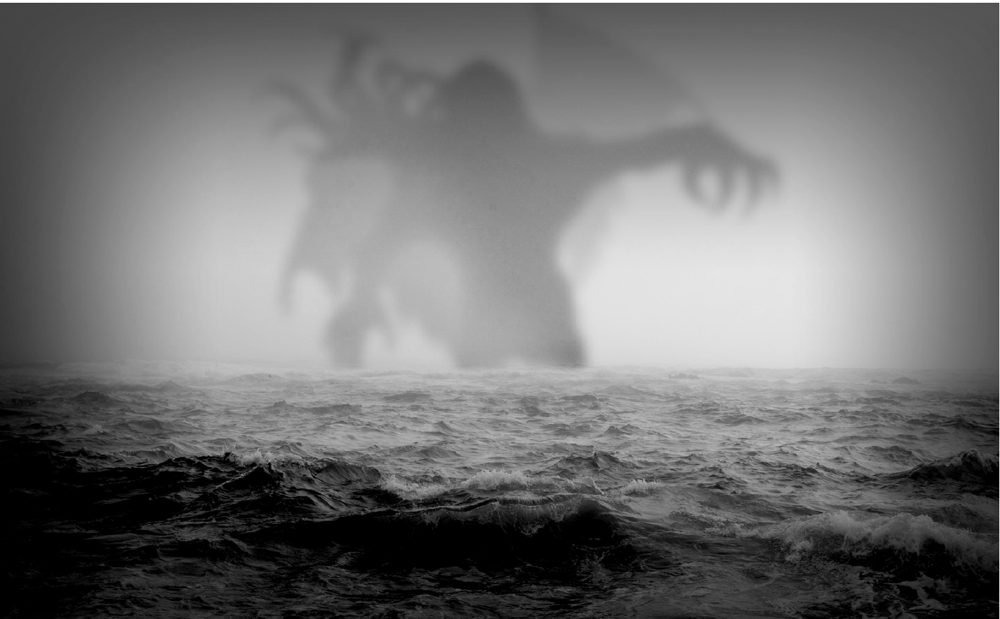

### Ритуал завершён

Конечно, одна из возможных концовок сценария — сыщики не успевают помешать Андреа завершить ритуал. Когда они доберутся до туннелей, Андреа останется влить в идола лишь несколько пунктов магии; если сыщики слишком долго будут добираться до сокровищницы, Хранитель может решить, что время вышло. Прежде чем закончить сценарий таким образом, Хранителю следует дать игрокам понять, что они слишком медлят и вот-вот случится что-то плохое; но если они и дальше будут тянуть время — сами напросились!

Ещё эта концовка может случиться, если Дэниел уговорит сыщиков бежать из пещер в какое-нибудь «безопасное» место вроде паба или если они сами решат спрятаться.

Наконец, эта концовка может наступить потому, что все сыщики погибли — возможно, пав в последнем бою с Андреа или со скелетами Харботтла и его команды. В таком случае эта концовка может послужить очищающей «заставкой», которую Хранитель опишет как итог их поражения.

С завершением ритуала перед идолом открывается портал, и Андреа шагает сквозь него в Р’льех. В то же время из портала **выходит** нечто — звёздное отродье Ктулху. Это существо, освободившееся из Затонувшего Р’льеха спустя тысячелетия, воспользуется случаем полакомиться лакомыми кусочками, которые найдутся в деревне, а затем прошагает к морю и скроется под волнами. Если сыщики прячутся в деревне, эту концовку можно разыграть как отнимающее рассудок «чудесное спасение»: они увидят, как исполинская туша звёздного отродья прорывается из пещер и крушит деревню. А можно, если Хранитель захочет, использовать её как эффектный способ погубить всю группу!

В итоге этой концовки Портхоллоу фактически уничтожен. Власти спишут всё на стихийное бедствие — возможно, на катастрофическое наводнение или необъяснимое цунами.

# Награды и последствия

Если сыщики вернут Дэниела брату целым и невредимым, Стивен предложит им вознаграждение, которого хватит, чтобы повысить их **Средства** на +1d6. Если Дэниел погибнет, Стивен будет убит горем и, хотя и поблагодарит сыщиков за старания, платить им не станет.

Если сыщикам удастся вернуть карту Макгаффри Ндиди, она предложит каждому из них награду — редкую книгу из своей коллекции. Книги повышают на +1d6 процентных пунктов один навык из следующего списка: **Археология**, **История**, **Оккультизм**.

Если сыщики заберут из туннелей часть пиратского сокровища, это может повысить их Средства — в зависимости от того, сколько им удалось унести. Но что же сокровище? Какие ещё тёмные и зловещие предметы лежат среди дублонов и драгоценных камней? Если Хранитель захочет, это можно использовать как завязки для будущих сценариев.

А что же Реддингтон? Расскажут ли сыщики Закари, что случилось с его спутником? Если да, добрый историк, несомненно, будет обязан им в будущем.

Кроме того, в зависимости от того, что случилось в сценарии, Рассудок может повыситься или понизиться:

| Событие | Рассудок |
|---|---|
| Дэниел спасён | +1d6 |
| Андреа не дали активировать идола | +1d6 |
| Не удалось помешать Андреа активировать идола | −1d6 |

