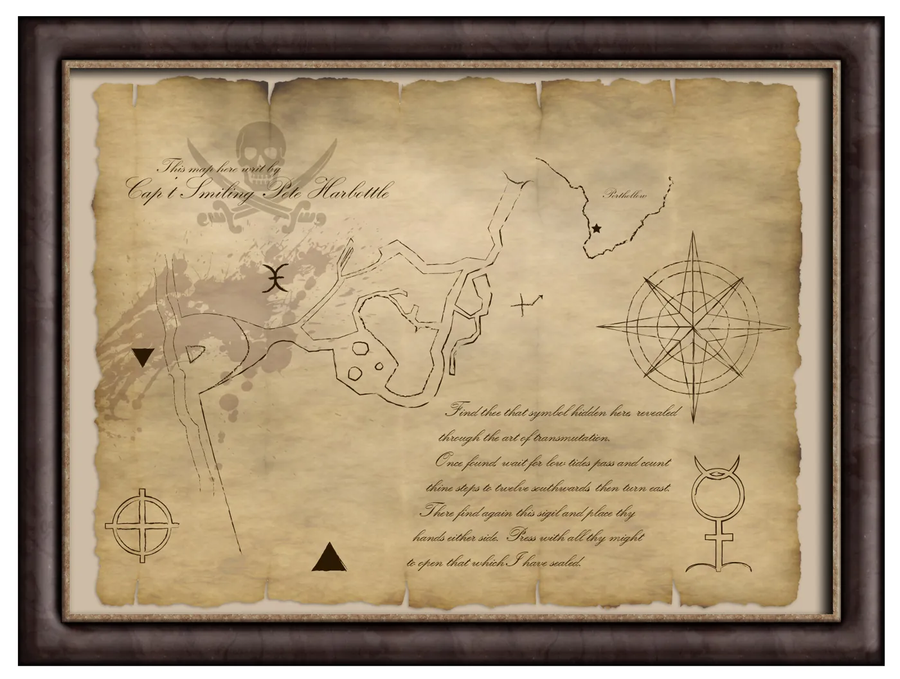
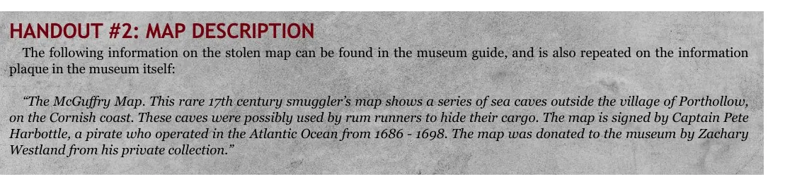

# Раздатка

*Ниже — каждая раздатка в оригинале (картинкой, для печати) и её перевод.*

## Раздатка 1: фотография карты

> **Раздатка 1: фотография карты**
>
> Это фото антикварной карты в рамке, снятое, когда карта висела на стене музея. Фото не слишком хорошее, но основное разобрать можно. Похоже, на карте изображена небольшая сеть пещер и место деревни, подписанной «Портхоллоу». Карта подписана неким капитаном Питом Харботтлом. Внимание привлекает странная загадка в правом нижнем углу карты.
>
> *«Найди тот знак, что здесь сокрыт и явлен искусством превращения. Найдя, дождись, как схлынет прилив, и отсчитай двенадцать шагов к югу, затем повернись на восток. Там снова найди сей знак и упрись руками по обе стороны от него. Дави изо всех сил, чтобы открыть то, что я запечатал».*
>
> *На самой карте: подпись в левом верхнем углу «This map here writ by Cap’t Smiling Pete Harbottle» («Сию карту начертал кап. Улыбчивый Пит Харботтл») поверх черепа со скрещёнными саблями; надпись «Porthollow» («Портхоллоу») у звёздочки на берегу; роза ветров; ход пещер; несколько знаков (крест в круге, треугольники, знак, похожий на ♓, крест) и алхимический символ — круг с рогами над крестом; в правом нижнем углу — текст загадки.*

<!-- -->

## Раздатка 2: описание карты

> **Раздатка 2: описание карты**
>
> Следующие сведения об украденной карте можно найти в путеводителе музея; они же повторены на информационной табличке в самом музее:
>
> *«Карта Макгаффри. Эта редкая карта контрабандистов XVII века показывает цепь морских пещер у деревни Портхоллоу на корнуолльском побережье. Возможно, в этих пещерах прятали свой груз перевозчики рома. Карта подписана капитаном Питом Харботтлом — пиратом, действовавшим в Атлантическом океане в 1686–1698 годах. Карту подарил музею из своей частной коллекции Закари Уэстленд».*
