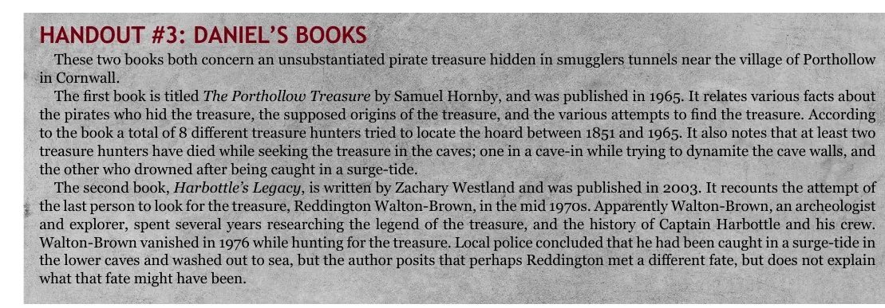
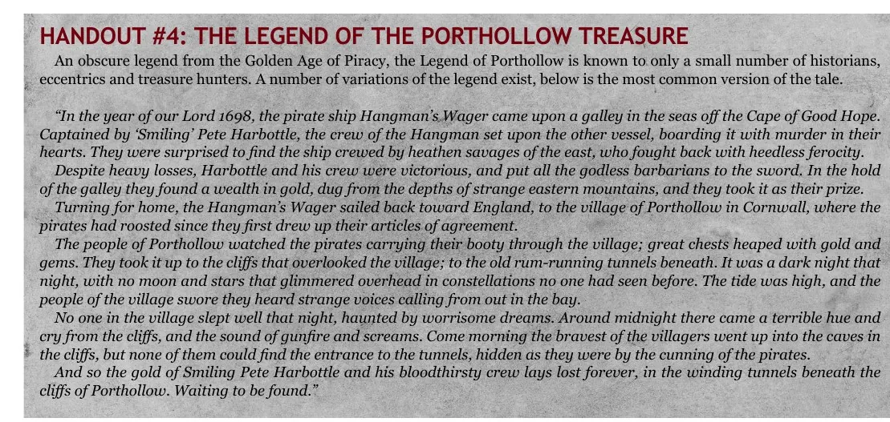
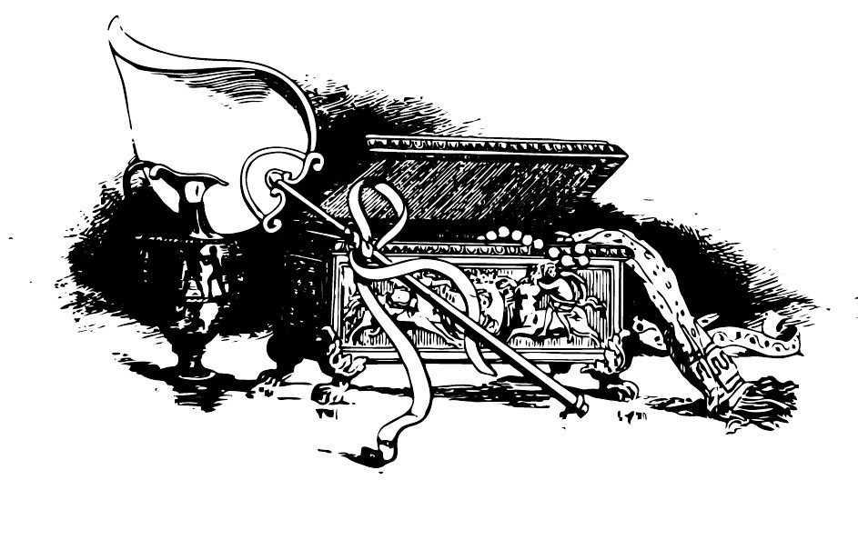

## Раздатка 3: книги Дэниела

> **Раздатка 3: книги Дэниела**
>
> Обе эти книги посвящены недоказанному пиратскому сокровищу, спрятанному в туннелях контрабандистов у деревни Портхоллоу в Корнуолле.
>
> Первая книга — «Сокровище Портхоллоу» (*The Porthollow Treasure*) Сэмюэла Хорнби, изданная в 1965 году. В ней изложены разные факты о пиратах, спрятавших сокровище, о предполагаемом происхождении сокровища и о разных попытках его найти. Согласно книге, с 1851 по 1965 год клад пытались отыскать в общей сложности 8 разных кладоискателей. В ней также отмечено, что по меньшей мере двое кладоискателей погибли, разыскивая сокровище в пещерах: один — при обвале, когда пытался взорвать динамитом стены пещеры, а другой утонул, застигнутый приливной волной.
>
> Вторая книга, «Наследие Харботтла» (*Harbottle’s Legacy*), написана Закари Уэстлендом и издана в 2003 году. В ней рассказывается о попытке последнего, кто искал сокровище, — Реддингтона Уолтон-Брауна — в середине 1970-х годов. По-видимому, Уолтон-Браун, археолог и путешественник, несколько лет изучал легенду о сокровище и историю капитана Харботтла и его команды. Уолтон-Браун пропал в 1976 году во время поисков сокровища. Местная полиция заключила, что его застала приливная волна в нижних пещерах и унесла в море, но автор предполагает, что Реддингтона, возможно, постигла иная судьба, однако не объясняет, какая именно.

<!-- -->

## Раздатка 4: легенда о сокровище Портхоллоу

> **Раздатка 4: легенда о сокровище Портхоллоу**
>
> Малоизвестная легенда Золотого века пиратства — легенда Портхоллоу — известна лишь немногим историкам, чудакам и кладоискателям. Существует несколько вариантов легенды; ниже приведена самая распространённая версия.
>
> *«В лето Господне 1698 пиратский корабль „Ставка висельника“ повстречал галеру в морях близ мыса Доброй Надежды. Команда „Висельника“ под началом капитана „Улыбчивого“ Пита Харботтла набросилась на тот корабль и взяла его на абордаж с убийством в сердце. Каково же было их удивление, когда они увидели, что корабль ведут языческие дикари с востока, которые бились с безоглядной яростью.*
>
> *Невзирая на тяжкие потери, Харботтл и его команда одолели и предали мечу всех безбожных варваров. В трюме галеры они нашли богатство в золоте, добытом в недрах странных восточных гор, и взяли его как свой трофей.*
>
> *Повернув домой, „Ставка висельника“ поплыла обратно к Англии, к деревне Портхоллоу в Корнуолле, где пираты свили себе гнездо с тех пор, как впервые составили свои артикулы.*
>
> *Жители Портхоллоу смотрели, как пираты несут через деревню свою добычу — огромные сундуки, доверху полные золота и самоцветов. Её отнесли наверх, к утёсам над деревней, в старые туннели ромовозов под ними. Ночь в ту ночь была тёмная, без луны, а звёзды над головой мерцали в созвездиях, каких никто прежде не видывал. Был прилив, и жители деревни клялись, что слышали странные голоса, звавшие из залива.*
>
> *Никто в деревне не спал спокойно в ту ночь — всех преследовали тревожные сны. Около полуночи с утёсов донеслись страшный шум и крики, звуки выстрелов и вопли. Наутро самые храбрые из жителей поднялись в пещеры в утёсах, но никто из них не смог найти вход в туннели — так хитро скрыли его пираты.*
>
> *Вот так и лежит золото „Улыбчивого“ Пита Харботтла и его кровожадной команды, навеки потерянное, в извилистых туннелях под утёсами Портхоллоу. И ждёт, когда его найдут».*

