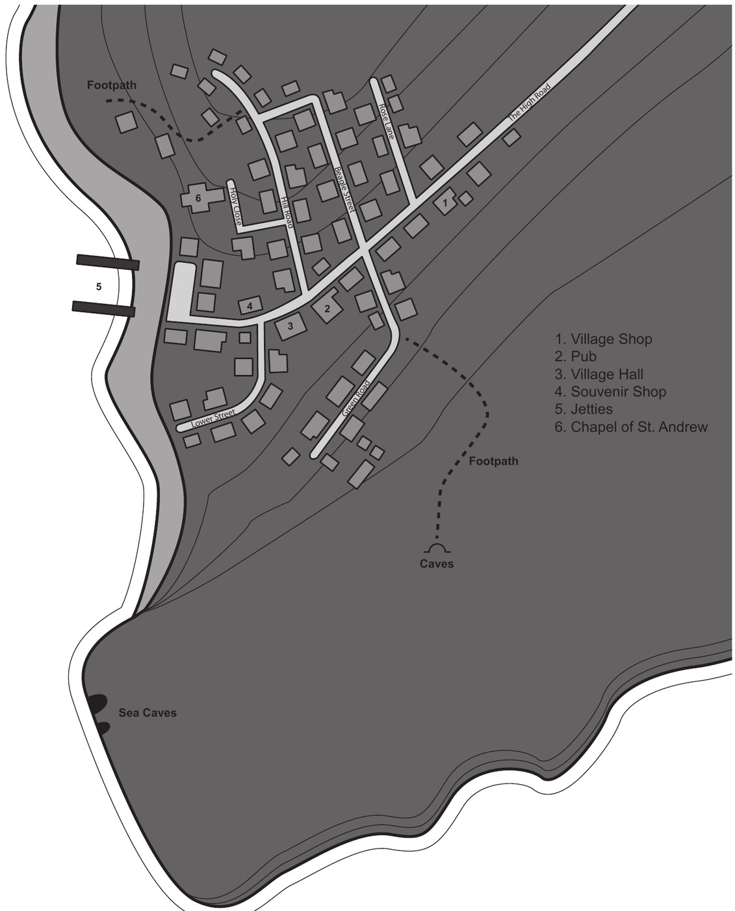

## Раздатка 5: карта Портхоллоу

> **Раздатка 5: карта Портхоллоу**
>
> Карта улиц Портхоллоу.
>
> 1. Деревенский магазин
> 2. Паб
> 3. Деревенский клуб
> 4. Сувенирная лавка
> 5. Причалы
> 6. Часовня Святого Андрея
>
> *Подписи на карте: улицы — Главная дорога (The High Road), Роуз-лейн (Rose Lane), Бигл-стрит (Beagle Street), Холи-Клоуз (Holy Close), Хилл-роуд (Hill Road), Грин-роуд (Green Road), Лоуэр-стрит (Lower Street); тропа (Footpath, дважды), пещеры (Caves), морские пещеры (Sea Caves).*

*Номера на карте для игроков (1–6) не совпадают с номерами на карте Хранителя (1–10, с. 13).*
