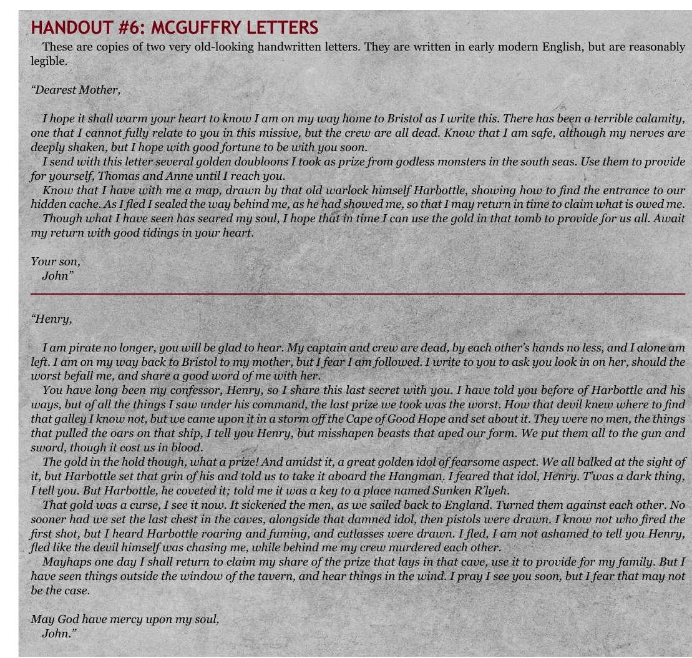
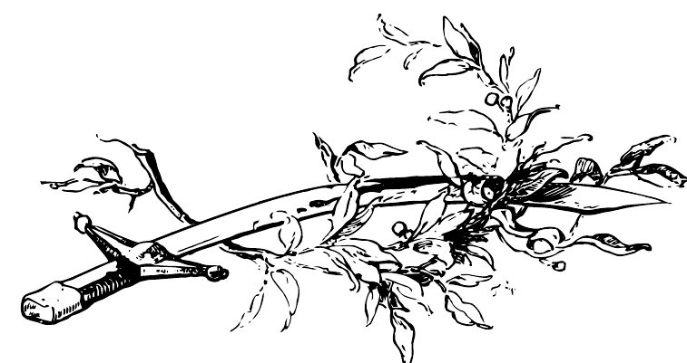

## Раздатка 6: письма Макгаффри

> **Раздатка 6: письма Макгаффри**
>
> Это копии двух очень старых на вид рукописных писем. Они написаны на ранненовоанглийском языке, но читаются довольно легко.
>
> *«Дражайшая матушка,*
>
> *надеюсь, тебе отрадно будет узнать, что, когда я пишу сие, я на пути домой, в Бристоль. Стряслось страшное бедствие, о коем не могу я поведать тебе всего в этом послании, но вся команда мертва. Знай, что я цел, хоть нервы мои и сильно расстроены, и, даст Бог, скоро буду с тобою.*
>
> *Посылаю с этим письмом несколько золотых дублонов, что взял я в добычу у безбожных чудовищ в южных морях. Употреби их, чтобы содержать себя, Томаса и Анну, покуда я не доберусь до вас.*
>
> *Знай, что при мне карта, начерченная самим этим старым колдуном Харботтлом, — она показывает, как найти вход в наш потайной схрон. Убегая, я запечатал за собою путь, как он меня научил, дабы со временем вернуться и забрать то, что мне причитается.*
>
> *Хоть увиденное мною и опалило мне душу, надеюсь со временем на золото из той гробницы обеспечить всех нас. Жди моего возвращения с добрыми надеждами в сердце.*
>
> *Твой сын*
> *Джон»*

<!-- -->

> *«Генри,*
>
> *ты будешь рад услышать, что я больше не пират. Капитан мой и команда мертвы — и не от чего-нибудь, а от рук друг друга, — и остался я один. Я возвращаюсь в Бристоль, к матушке, но боюсь, что за мной следят. Пишу тебе, чтобы просить: если со мною случится худшее, наведывайся к ней да замолви ей обо мне доброе слово.*
>
> *Ты давно уж мой исповедник, Генри, так что поделюсь с тобою последней тайной. Я и прежде рассказывал тебе о Харботтле и его повадках, но из всего, что видел я под его началом, последняя наша добыча была хуже всего. Откуда этот дьявол знал, где сыскать ту галеру, мне неведомо, но мы настигли её в шторм у мыса Доброй Надежды и напали на неё. Не люди то были, кто сидел на вёслах того корабля, говорю тебе, Генри, а уродливые твари, обезьянничавшие нашим обличьем. Всех мы их предали пуле и сабле, хоть и заплатили за то кровью.*
>
> *Но золото в трюме — вот уж добыча! А среди него — огромный золотой идол грозного вида. Все мы попятились при виде его, но Харботтл ухмыльнулся этой своей ухмылкой и велел взять его на борт „Висельника“. Я боялся этого идола, Генри. Тёмная то была вещь, говорю тебе. А Харботтл его возжелал; сказал мне, что это ключ к месту, что зовётся Затонувший Р’льех.*
>
> *То золото было проклятием, теперь я это вижу. Пока плыли мы назад в Англию, оно сделало людей больными. Обратило их друг против друга. Едва мы поставили последний сундук в пещерах, рядом с тем проклятым идолом, как выхватили пистолеты. Не ведаю, кто выстрелил первым, но я слышал, как ревел и бушевал Харботтл, и обнажились сабли. Я бежал — не стыжусь сказать тебе, Генри, — бежал, будто сам дьявол гнался за мною, а позади меня моя команда резала друг друга.*
>
> *Может статься, однажды я вернусь забрать свою долю добычи, что лежит в той пещере, и обеспечить ею свою семью. Но я видел кое-что за окном таверны и слышу кое-что в ветре. Молюсь, чтобы скоро свидеться с тобою, но боюсь, что не бывать тому.*
>
> *Да смилуется Господь над моей душой,*
> *Джон»*

