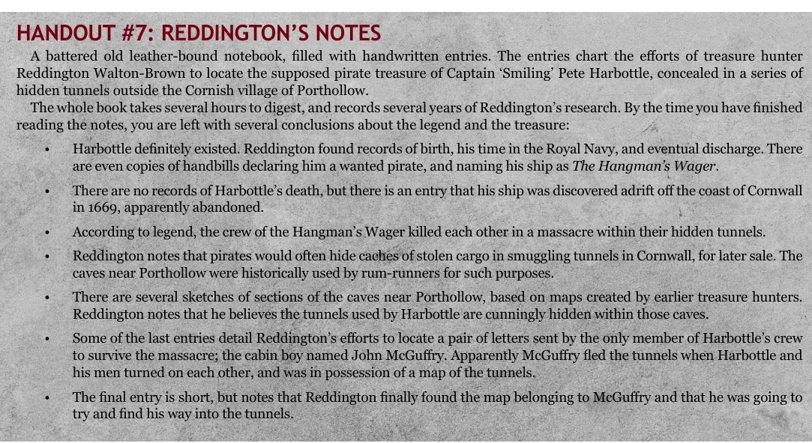
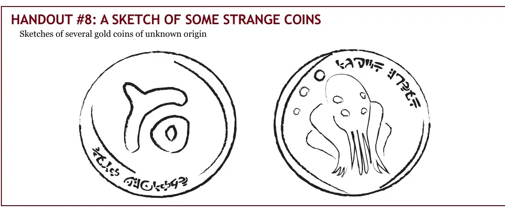
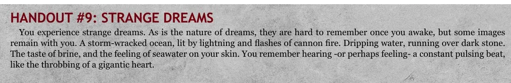
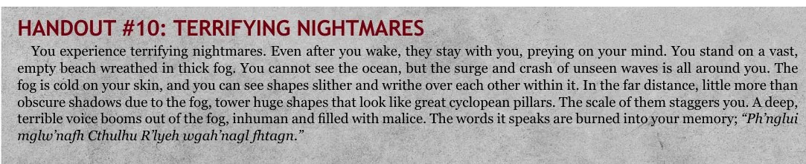

## Раздатка 7: записи Реддингтона

> **Раздатка 7: записи Реддингтона**
>
> Потрёпанная старая записная книжка в кожаном переплёте, заполненная рукописными записями. Записи прослеживают усилия кладоискателя Реддингтона Уолтон-Брауна найти предполагаемое пиратское сокровище капитана «Улыбчивого» Пита Харботтла, спрятанное в сети потайных туннелей у корнуолльской деревни Портхоллоу.
>
> Чтобы осмыслить всю книжку, нужно несколько часов; в ней отражены несколько лет изысканий Реддингтона. Дочитав записи, вы приходите к нескольким выводам о легенде и сокровище:
>
> - Харботтл точно существовал. Реддингтон нашёл записи о его рождении, о его службе в Королевском флоте и о том, как его в конце концов уволили со службы. Есть даже копии листовок, объявлявших его разыскиваемым пиратом и называвших его корабль — «Ставка висельника».
> - Записей о смерти Харботтла нет, но есть запись о том, что его корабль нашли дрейфующим у берегов Корнуолла в 1669 году — по-видимому, брошенным.
> - Согласно легенде, команда «Ставки висельника» перебила друг друга в резне в своих потайных туннелях.
> - Реддингтон отмечает, что пираты часто прятали тайники с краденым грузом в контрабандистских туннелях Корнуолла, чтобы потом его продать. Пещеры у Портхоллоу исторически использовали для этого ромовозы.
> - Есть несколько набросков участков пещер у Портхоллоу, сделанных по картам прежних кладоискателей. Реддингтон отмечает, что, по его мнению, туннели, которыми пользовался Харботтл, хитро спрятаны внутри этих пещер.
> - В одних из последних записей подробно описано, как Реддингтон пытался разыскать два письма, отправленные единственным членом команды Харботтла, пережившим резню, — юнгой по имени Джон Макгаффри. По-видимому, Макгаффри бежал из туннелей, когда Харботтл и его люди набросились друг на друга, и у него была карта туннелей.
> - Последняя запись короткая, но в ней сказано, что Реддингтон наконец нашёл карту, принадлежавшую Макгаффри, и собирается попытаться проникнуть в туннели.

*Прим. перев.: так в оригинале — «в 1669 году»; это противоречит остальной книге (Харботтл командовал «Ставкой висельника» в 1686–1698 годах и вернулся в Портхоллоу в 1698-м), вероятно, перестановка цифр (1698 или позже). В тексте раздатки оставлено как напечатано.*

## Раздатка 8: набросок странных монет

> **Раздатка 8: набросок странных монет**
>
> Наброски нескольких золотых монет неизвестного происхождения.
>
> *[на рисунке — две монеты: на одной крупный знак-завиток и надпись незнакомыми письменами по краю, на другой — головоногое существо со щупальцами в окружении кружков и надпись теми же письменами]*

<!-- -->

## Раздатка 9: странные сны

> **Раздатка 9: странные сны**
>
> Вам снятся странные сны. Как это бывает со снами, проснувшись, их трудно вспомнить, но какие-то образы остаются. Исхлёстанный бурей океан в отсветах молний и вспышках пушечного огня. Вода, бегущая по тёмному камню. Вкус соли и ощущение морской воды на коже. Вы помните, что слышали — а может, чувствовали — непрестанный пульсирующий ритм, словно биение гигантского сердца.

<!-- -->

## Раздатка 10: ужасные кошмары

> **Раздатка 10: ужасные кошмары**
>
> Вам снятся ужасные кошмары. Даже после пробуждения они не отпускают вас, терзая разум. Вы стоите на огромном пустом пляже, окутанном густым туманом. Океана не видно, но вокруг — накат и грохот невидимых волн. Туман холодит кожу, и вы видите, как в нём что-то извивается и ползёт друг по другу. Вдали, едва различимые тени в тумане, высятся огромные формы — как гигантские циклопические колонны. Их размер ошеломляет. Из тумана гремит низкий страшный голос, нечеловеческий и полный злобы. Его слова выжжены в вашей памяти: *«Ph’nglui mglw’nafh Cthulhu R’lyeh wgah’nagl fhtagn»*.
