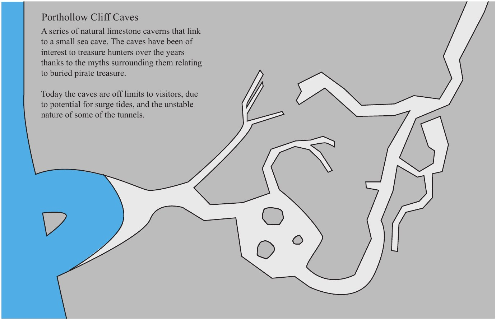

## Раздатка 11: карта пещер

> **Раздатка 11: карта пещер**
>
> Похоже, это карта пещер у Портхоллоу.
>
> *«Пещеры в утёсах Портхоллоу*
>
> *Цепь природных известняковых пещер, соединённых с небольшим морским гротом. Пещеры издавна привлекали кладоискателей из-за мифов о спрятанном пиратском сокровище.*
>
> *Сегодня вход для посетителей закрыт из-за опасности приливных волн и неустойчивости некоторых ходов».*

