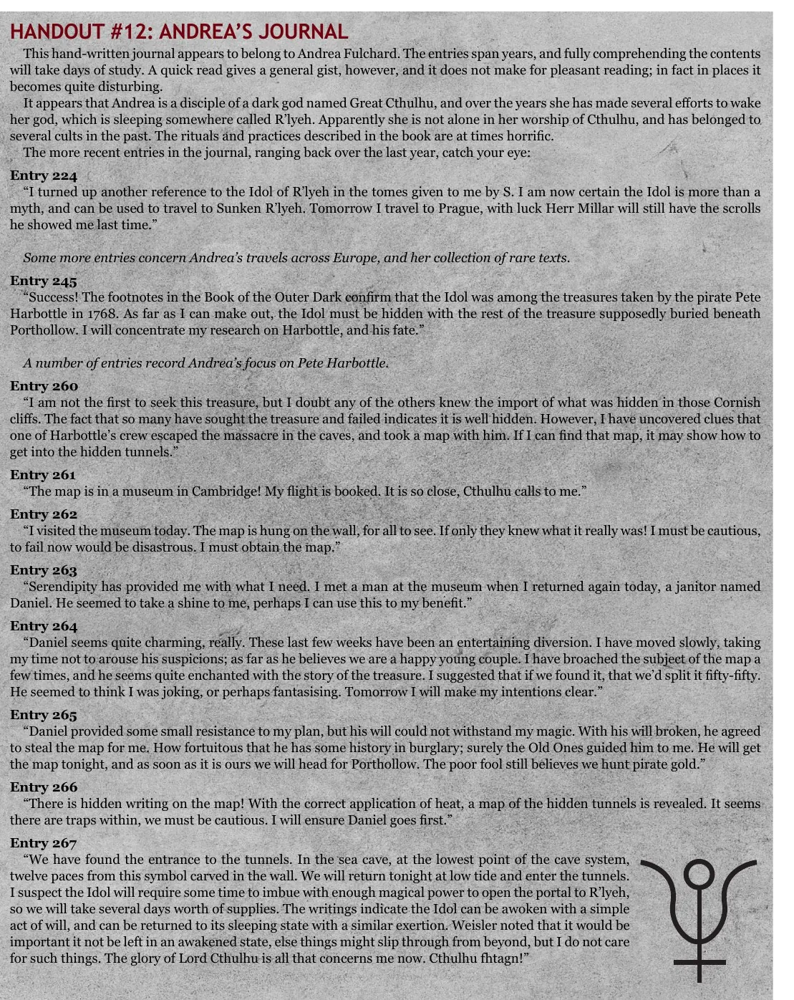

## Раздатка 12: дневник Андреа

> **Раздатка 12: дневник Андреа**
>
> Этот рукописный дневник, по-видимому, принадлежит Андреа Фулчард. Записи охватывают годы, и чтобы полностью понять содержание, нужны дни изучения. Однако беглое чтение даёт общее представление, и читать это неприятно, а местами и по-настоящему тревожно.
>
> Похоже, Андреа — последовательница тёмного бога по имени Великий Ктулху, и за эти годы она не раз пыталась разбудить своего бога, который спит где-то в месте под названием Р’льех. По-видимому, она не одинока в поклонении Ктулху и в прошлом состояла в нескольких культах. Обряды и обычаи, описанные в книге, местами ужасны.
>
> Ваше внимание привлекают последние записи дневника — за последний год:
>
> **Запись 224**
>
> *«В фолиантах, которые дал мне С., я нашла ещё одно упоминание об Идоле Р’льеха. Теперь я уверена, что Идол — не просто миф и что с его помощью можно попасть в Затонувший Р’льех. Завтра еду в Прагу; если повезёт, у герра Миллара ещё остались свитки, которые он показывал мне в прошлый раз».*
>
> *Ещё несколько записей — о поездках Андреа по Европе и о собранных ею редких текстах.*
>
> **Запись 245**
>
> *«Успех! Сноски в „Книге Внешней Тьмы“ подтверждают, что Идол был среди сокровищ, захваченных пиратом Питом Харботтлом в 1768 году. Насколько я могу понять, Идол должен быть спрятан вместе с остальным сокровищем, которое якобы зарыто под Портхоллоу. Сосредоточу свои изыскания на Харботтле и его судьбе».*
>
> *Ряд записей посвящён тому, как Андреа изучала Пита Харботтла.*
>
> **Запись 260**
>
> *«Я не первая, кто ищет это сокровище, но сомневаюсь, что кто-нибудь из прочих понимал значение того, что спрятано в тех корнуолльских утёсах. То, что столь многие искали сокровище и потерпели неудачу, говорит о том, что оно хорошо спрятано. Однако я нашла указания на то, что один из команды Харботтла спасся от резни в пещерах и унёс с собой карту. Если я найду эту карту, она, возможно, покажет, как попасть в потайные туннели».*
>
> **Запись 261**
>
> *«Карта — в музее в Кембридже! Билет на самолёт заказан. Это так близко, Ктулху зовёт меня».*
>
> **Запись 262**
>
> *«Сегодня побывала в музее. Карта висит на стене, у всех на виду. Если бы они только знали, что это на самом деле! Надо быть осторожной: провал сейчас был бы катастрофой. Я должна заполучить карту».*
>
> **Запись 263**
>
> *«Счастливый случай дал мне то, что нужно. Когда я сегодня снова пришла в музей, я познакомилась там с мужчиной — уборщиком по имени Дэниел. Кажется, я ему приглянулась; может быть, я смогу обратить это себе на пользу».*
>
> **Запись 264**
>
> *«Дэниел, в сущности, довольно мил. Последние несколько недель были занятным развлечением. Я действовала медленно, не торопясь, чтобы не вызвать у него подозрений; насколько он верит, мы — счастливая молодая пара. Несколько раз я заговаривала о карте, и, похоже, история сокровища его совершенно очаровала. Я предложила, если мы его найдём, поделить его пополам. Он, кажется, решил, что я шучу или, может быть, фантазирую. Завтра я ясно дам понять свои намерения».*
>
> **Запись 265**
>
> *«Дэниел немного противился моему замыслу, но его воля не устояла перед моей магией. Сломив его волю, я добилась, что он согласился украсть для меня карту. Как удачно, что у него есть кое-какой опыт краж со взломом; наверняка его привели ко мне Древние. Сегодня ночью он добудет карту, и, как только она станет нашей, мы отправимся в Портхоллоу. Бедный дурак всё ещё думает, что мы ищем пиратское золото».*
>
> **Запись 266**
>
> *«На карте есть скрытая надпись! Если правильно её нагреть, проступает карта потайных туннелей. Похоже, внутри есть ловушки, нужно быть осторожными. Позабочусь о том, чтобы первым шёл Дэниел».*
>
> **Запись 267**
>
> *«Мы нашли вход в туннели. В морском гроте, в самой нижней точке пещер, в двенадцати шагах от этого знака, вырезанного в стене. Вернёмся сегодня ночью в отлив и войдём в туннели. Подозреваю, что понадобится время, чтобы напитать Идол магической силой, достаточной для открытия портала в Р’льех, так что возьмём припасов на несколько дней. Записи указывают, что Идол можно пробудить простым усилием воли и таким же усилием вернуть в спящее состояние. Вайслер отмечал, что важно не оставлять его в пробуждённом состоянии, иначе из-за грани может что-нибудь проскользнуть, но мне нет дела до подобных вещей. Теперь меня заботит только слава владыки Ктулху. Cthulhu fhtagn!»*
>
> *[рядом с записью нарисован знак — круг над перевёрнутой дугой, похожей на рога или трезубец, и крест под ней]*

*Прим. перев.: так в оригинале — «в 1768 году»; везде в книге Харботтл захватил сокровище и Идол в 1698 году, вероятно, опечатка. В тексте раздатки оставлено как напечатано.*
