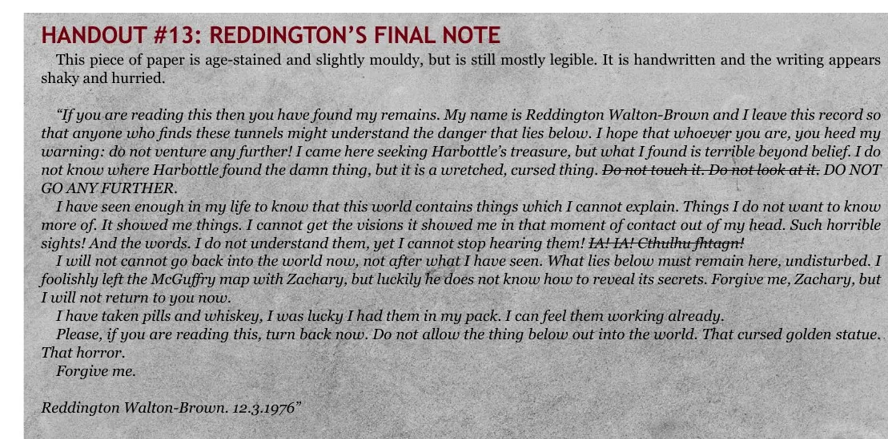
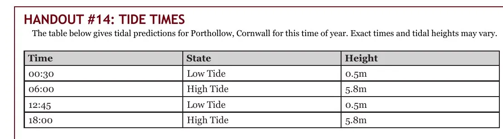
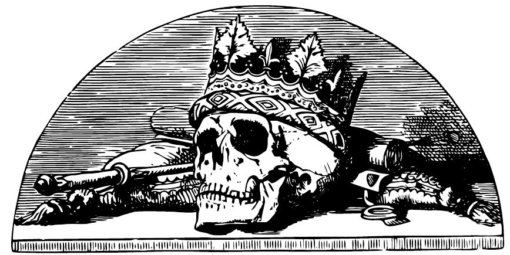

## Раздатка 13: последняя записка Реддингтона

> **Раздатка 13: последняя записка Реддингтона**
>
> Этот листок бумаги покрыт пятнами от времени и слегка заплесневел, но в основном всё ещё читается. Он исписан от руки, и почерк выглядит дрожащим и торопливым.
>
> *«Если вы читаете это, значит, вы нашли мои останки. Меня зовут Реддингтон Уолтон-Браун, и я оставляю эту запись, чтобы всякий, кто найдёт эти туннели, понял, какая опасность лежит дальше. Надеюсь, кто бы вы ни были, вы прислушаетесь к моему предупреждению: не ходите дальше! Я пришёл сюда в поисках сокровища Харботтла, но то, что я нашёл, ужасно сверх всякого вероятия. Не знаю, где Харботтл раздобыл эту чёртову вещь, но это жалкая, проклятая вещь. <del>Не трогайте её. Не смотрите на неё.</del> НЕ ХОДИТЕ ДАЛЬШЕ.*
>
> *Я достаточно повидал в жизни, чтобы знать: в этом мире есть вещи, которых я не могу объяснить. Вещи, о которых я не хочу знать больше. Она показала мне кое-что. Я не могу выбросить из головы видения, которые она показала мне в тот миг соприкосновения. Какие ужасные картины! И слова. Я их не понимаю, но не могу перестать их слышать! <del>IA! IA! Cthulhu fhtagn!</del>*
>
> *Я не вернусь — не могу вернуться в мир теперь, после того, что я видел. То, что лежит внизу, должно остаться здесь, нетронутым. По глупости я оставил карту Макгаффри Закари, но, к счастью, он не знает, как раскрыть её тайны. Прости меня, Закари, но теперь я к тебе не вернусь.*
>
> *Я принял таблетки и виски — к счастью, они оказались у меня в рюкзаке. Я уже чувствую, как они действуют.*
>
> *Прошу вас, если вы читаете это, поверните назад сейчас же. Не выпускайте в мир то, что внизу. Эту проклятую золотую статую. Этот ужас.*
>
> *Простите меня.*
>
> *Реддингтон Уолтон-Браун. 12.3.1976»*
>
> *[в оригинале слова «Не трогайте её. Не смотрите на неё.» и «IA! IA! Cthulhu fhtagn!» зачёркнуты]*

<!-- -->

## Раздатка 14: время приливов

> **Раздатка 14: время приливов**
>
> Таблица ниже даёт прогноз приливов для Портхоллоу (Корнуолл) на это время года. Точное время и высота могут отличаться.
>
> | Время | Состояние | Высота |
> |---|---|---|
> | 00:30 | Отлив | 0,5 м |
> | 06:00 | Прилив | 5,8 м |
> | 12:45 | Отлив | 0,5 м |
> | 18:00 | Прилив | 5,8 м |

