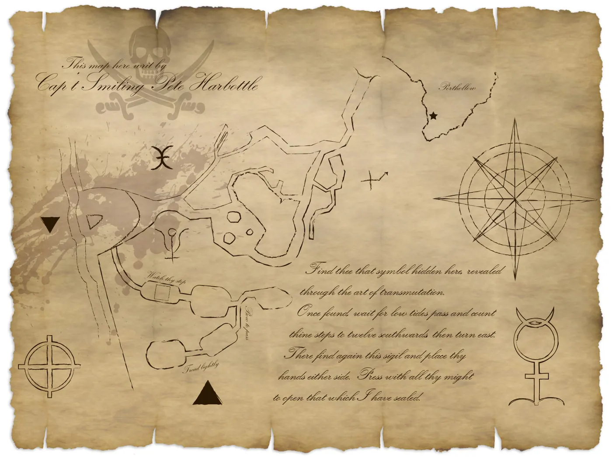

## Карта Макгаффри

*Карта Макгаффри целиком — с пометками, проявляющимися при нагревании (страница без текста; в книге карта повёрнута на бок). Подписи на карте: «This map here writ by Cap’t Smiling Pete Harbottle» («Сию карту начертал кап. Улыбчивый Пит Харботтл»); «Porthollow» («Портхоллоу») у звёздочки на берегу; текст загадки (см. раздатку 1); роза ветров; охранные и алхимические знаки. Проявившийся план потайных туннелей с пометками у ловушек: «Watch thy step» («Смотри под ноги») — у зала-ловушки, «Bow to pass» («Поклонись, чтобы пройти») — у ловушки с лезвиями, «Tread lightly» («Ступай легко») — у ловушки с камнепадом; у входа в туннели — знак, отмечающий потайную дверь.*
