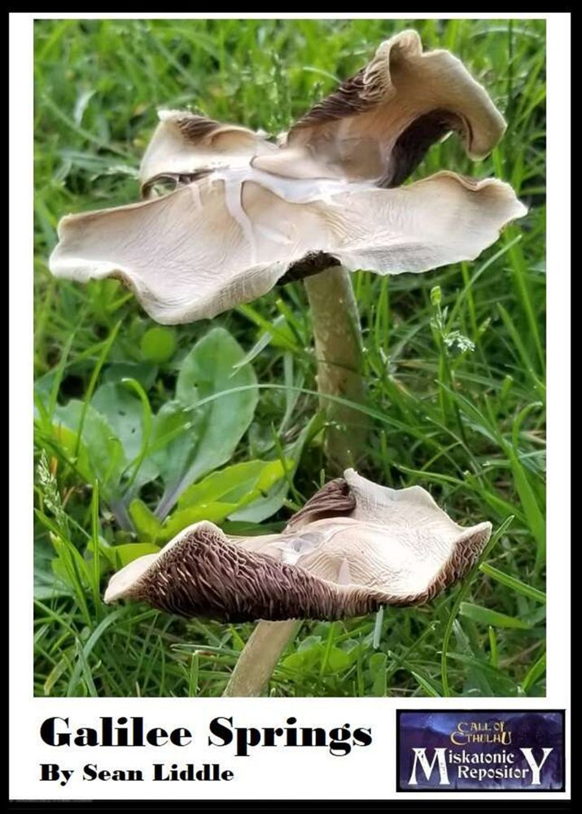

ГАЛИЛИ-СПРИНГС

Шон Лиддл

*На обложке — фотография двух грибов в траве; внизу — название «Galilee Springs», имя автора (By Sean Liddle) и логотип «Call of Cthulhu — Miskatonic Repository».*

*Прим. перев.: в названии файла оригинала — «Gallilee Springs», на обложке и в тексте — «Galilee Springs».*
