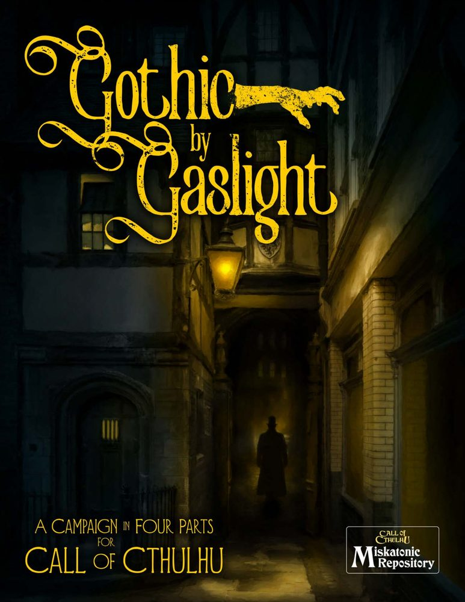

ГОТИКА ГАЗОВОГО СВЕТА

Кампания в четырёх частях для «Зова Ктулху»

*На обложке — узкий ночной переулок старого Лондона, газовый фонарь над аркой и тёмная фигура в цилиндре вдали; название «Gothic by Gaslight» с рукой-когтем, подзаголовок «A Campaign in Four Parts for Call of Cthulhu» и логотип «Call of Cthulhu — Miskatonic Repository».*
