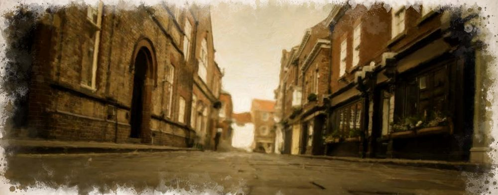

# Глава 1. Жуткие дела при газовом свете

Конец XIX века, Соединённое Королевство — время и место, где свет газовых фонарей никак не может до конца разогнать тьму.

Литература Британии эпохи Газового света полна новых ужасов и обаятельных чудовищ. Мэри Шелли, Роберт Льюис Стивенсон, Жюль Верн, а вскоре и Брэм Стокер и сотни менее известных писак выпускают в свет легионы чудесных и страшных историй. Публика жадно глотает их, упиваясь ими в журналах с продолжением и в дешёвых, захватывающих книжонках, которые зовут «грошовыми ужастиками» (Penny Dreadfuls). В самом сердце этого литературного водоворота — лондонская улица Патерностер-роу, где обитают одни из самых знаменитых и почтенных издателей и книготорговцев эпохи.

На ней же обитает и одна организация чуть менее почтенная. «Книжный клуб» на Патерностер-роу, 18 — отчасти светский клуб, отчасти типография, отчасти книжная лавка. А ещё — тайное прибежище кучки нежелательных лондонцев, которые расследуют отвратительные тайны и издают едва прикрытые вымыслом описания своих похождений. Члены Книжного клуба взяли себе слегка насмешливое прозвище «Ужастики» — по той безвкусной литературе, что приносит клубу большую часть дохода.

Ужастикам известна одна тайна, которой не знает остальная Патерностер-роу: великие литературные произведения века в жанре ужасов и научной фантастики не были чистым вымыслом. Это были завуалированные предостережения об угрозах куда более странных, чем любая выдумка, написанные сыщиками сверхъестественного и для них же. А вот чего Ужастики ещё не знают, но вот-вот узнают: могущественная фигура действует в тени, чтобы выпустить на волю чудовищ — и старых, и новых.

В эту дерзкую новую эпоху, когда порядок и прогресс воюют с косной традицией, чудовища, которым полагалось быть вымышленными, снова рыщут по Британской империи:

*Забытый флакон опасной настойки выпускает в Сохо на волю самые тёмные побуждения человечества.*

*Безумный учёный, похитивший искру жизни, ищет новых, ещё более странных богов, у которых можно украсть.*

*Великая любовь, некогда отвергнутая, теперь ведёт смертоносную кампанию мести на море.*

*А за всем этим стоит обаятельная старушка, полная жизни, живо интересующаяся Ужастиками и говорящая с едва заметным восточноевропейским акцентом.*

## Что такое «Готика газового света»?

«Готика газового света» — короткая кампания для седьмой редакции «Зова Ктулху». Она воспевает готические истории ужасов эпохи Газового света, придавая классическим сюжетам и злодеям оттенок космического ужаса. Игроки по-новому встретятся со знакомыми чудовищами в захватывающей и опасной кампании в Лондоне и в остальном Соединённом Королевстве.

Кампания состоит из четырёх сценариев и необязательной «нулевой сессии», которая помогает представить сыщиков, определить их прошлое и мотивы. Каждый сценарий можно сыграть отдельно, как одиночное приключение, или объединить их в кампанию и дополнить сценами, которые происходят в общей организации сыщиков — Книжном клубе.

Сценарии развивают классику викторианской и готической литературы — «Странную историю доктора Джекила и мистера Хайда», «Франкенштейна» и «Двадцать тысяч льё под водой», — а также вампирскую литературу эпохи Газового света, например «Дракулу» и «Кармиллу».
