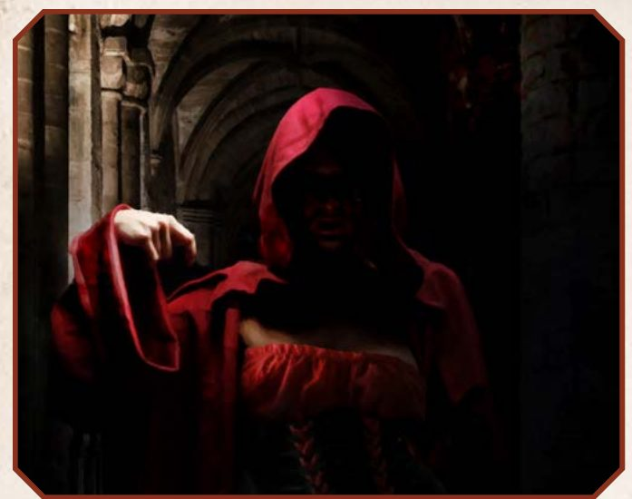

## Знакомьтесь: Графиня

За каждым из сценариев этой кампании стоит чародейка Мифов с вампирскими чертами, которую зовут «Графиней». Если играть сценарии по отдельности, её участие можно опустить или лишь намекнуть на него. Если же играть их как кампанию, Графиня заводит с сыщиками танец, который приведёт либо к её собственной гибели, либо к падению Британской империи.

«Графиня» когда-то была Елизаветой Батори — венгерской аристократкой XVI века и, если верить пересудам современников, плодовитой серийной убийцей. Согласно наветам, которые распускали её политические враги, она со своими слугами убила сотни девушек и молодых женщин и купалась в их крови, надеясь обрести вечную молодость.

Её и её любимых слуг судили за колдовство. Слуг казнили, а Батори заточили в её собственном доме. Одинокая, сломленная врагами, отрезанная от всех источников жизни и радости, она обратилась к чародейству Мифов. Став в самом деле тем чудовищем, в котором её обвиняли враги, она крестилась кровью и коснулась чего-то Запредельного — сущности из-за пределов наших измерений, которая связала себя с ней через бесконечность пространства. Сущность даровала ей вечную жизнь и сверхъестественные силы; взамен этот Консорт досыта пьёт жизненную силу, которую находит на земле, упиваясь необузданными страстями и исступлёнными чувствами.

Теперь Батори и сущность одержимы одним — жизнью: стереть границу между жизнью и смертью, принять человеческие страсти, отдать всё ради любви и желания. Вместе они стремятся сделать человечество *«свободным и диким, по ту сторону добра и зла»*.

Стремясь построить мир, который лучше ей подходит, она и её Консорт воплощают противоположность викторианской морали. Там, где королева Виктория и её империя застёгнуты на все пуговицы, одержимы смертью, подавлены и тревожны, Графиня и её Консорт хотят благословить Британские острова жизнью — вечной и необузданной, дикой и разрастающейся, как опухоль. Она и её потусторонний Консорт либо целиком покорят викторианский строй, либо погибнут в этой попытке.

## Сводка кампании

В кампании четыре сценария. Поскольку их можно играть и по отдельности, и как кампанию, сюжетная связь между ними довольно свободная. Хранитель может пренебречь этими связями или переделать их под другую цель — например, связать сценарии с более долгой кампанией в эпохе Газового света, которую он ведёт.

Между сценариями проходит по несколько лет. Хранитель может вставить в эти промежутки другие сценарии или сцены, исследовать трагическую готическую предысторию сыщиков или просто переходить от одного сценария к следующему. Спешить незачем: Графиня будет их ждать. Вот четыре сценария:

### Прятки с Хайдом (1886)

Через несколько месяцев после загадочной смерти печально известного убийцы Эдварда Хайда и его покровителя доктора Генри Джекила в Сохо воцарился зыбкий покой. Но в оккультных кругах ходят шёпотом слухи о причастности Джекила к странной сыворотке, которая будто бы и породила мистера Хайда. Когда в прежних охотничьих угодьях Хайда обнаруживают череду жестоких убийств, Ужастики понимают, что кошмар, возможно, вовсе не кончился.

### Дитя Франкенштейна (1887)

Доктор Виктор Франкенштейн и его чудовище существовали на самом деле, а трагическая повесть из классического романа Мэри Шелли умолчала о некоторых важных подробностях. Теперь грехи прошлого приносят плоды: сын доктора Франкенштейна задался целью превзойти отца — не только бросить вызов смерти, но и завладеть силой самих богов.

### Леди Немо (1894)

Череду судов атакует и топит нечто, что бульварные листки зовут «морским чудовищем». Ужастикам предстоит выяснить истинную причину этих морских катастроф — и столкнуться лицом к лицу со вдовой, которую любовь толкнула на страшную месть.

### Графиня (1896)

Во время юбилея королевы Виктории восходит другая королева: Графиня готовится привести в действие свой замысел. На этот раз мишень — сами Ужастики: в сердце Книжного клуба хранится сокровище, ради обладания которым Графиня пойдёт на всё.
