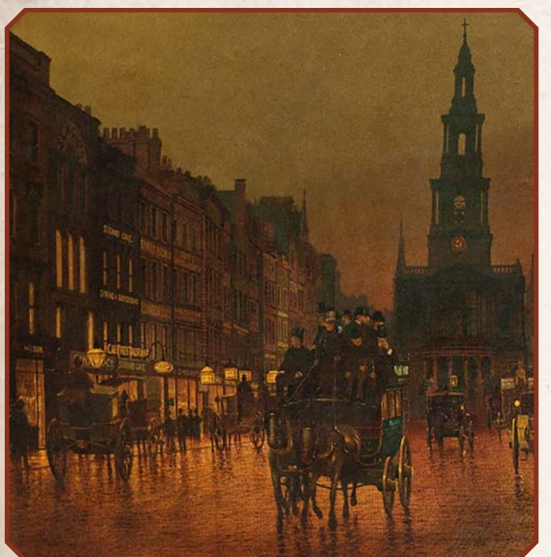
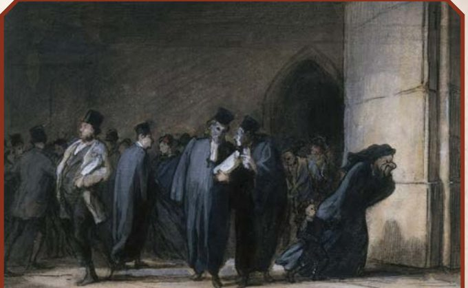

# Создание сыщика

Мы советуем игрокам создать для этой кампании новых сыщиков по описанному ниже порядку, чтобы персонажи хорошо подходили к готическим темам сценариев.

Создание сыщика идёт как обычно по «Книге хранителя» или «Книге сыщика» для «Cthulhu by Gaslight», с несколькими особыми элементами этой кампании. Сыщики могут быть любого сословия и любой профессии, но вы, возможно, заметите, что некоторые профессии естественнее подходят Ужастикам; они перечислены ниже.

> **Советы по пульп-архетипам**
>
> *«Готика газового света» отлично подходит для игры по Pulp. Если ваша группа выберет правила Pulp, понадобится книга «Pulp Cthulhu»; **основная характеристика**, **Удача**, **влияние возраста**, **пункты здоровья** и **пульп-таланты** определяются по правилам Pulp.*
>
> *Первым шагом создания каждому сыщику нужен пульп-архетип. Книжный клуб, конечно, привлекает литературные и артистические натуры, а также людей авантюрного склада, которые могут дать пищу для грошовых ужастиков, выпускаемых клубом, но и люди более трезвого или зловещего нрава вполне могут чувствовать себя в клубе как дома. Из архетипов, предложенных в книге правил, члену Ужастиков лучше всего подходят: **искатель приключений**; **бонвиван**; **мечтатель**; **яйцеголовый**; **первопроходец**; **мистик**; **чужак**; **плут**; **эрудит**; **искатель истины**; **сорвиголова**.*

## Рекомендуемые профессии эпохи Газового света

Ужастики набирают членов из всех слоёв общества. Первыми членами клуба были Мэри Шелли и её ближний круг (см. **Книжный клуб** ниже), но с годами клуб распахнул двери каждому, кто интересуется чтением, письмом или поддержкой интереса клуба к фантастическому, умозрительному и сверхъестественному. Клуб также вербует людей со специальными знаниями, полезными для расследований Ужастиков, — научными или мистическими, но, возможно, и менее благовидными, например как попасть в лондонские трущобы и ориентироваться в них. Раз уж сеть раскинута так широко, сословие значит меньше: тем, у кого нет свободных денег на членские взносы, их покрывают из общей кассы клуба.

Поэтому выбирайте понравившуюся профессию и не позволяйте сословию решать за вас. Особенно подходят такие профессии эпохи Газового света: **авантюристка**; **алиенист**; **антиквар**; **аристократ**; **художник**; **писатель**; **детектив-консультант**; **преступник**; **путешественник**; **джентльмен/леди**; **частный сыщик**; **журналист**; **врач**; **учёный**.

## Биография: готические вопросы о прошлом

Одна из главных черт готической литературы — прошлое непрестанно преследует настоящее. В этой кампании готических ужасов прошлое сыщиков тяжело давит на них, и мы передаём это особыми элементами их биографии.

Создавая сыщика для кампании «Готика газового света», ответьте не более чем на три из этих вопросов: так вы лучше поймёте, что движет сыщиком и что может привести его к трагическому падению.

Каждый ответ даёт сыщику пункт биографии, связанный с пунктами биографии на листе персонажа. Отвечая, бросьте по нужной таблице раздела **«Биография»** основной книги или следуйте подсказке.
