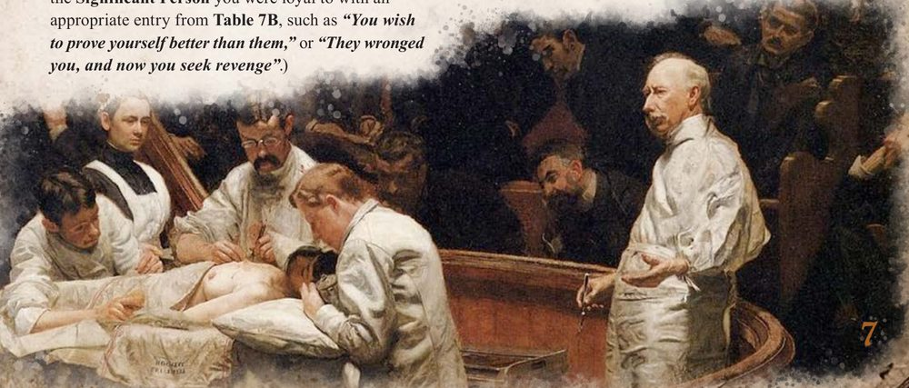

### Какова самая тёмная тайна вашего сыщика?

- Вы предали любимого человека. (Бросьте **значимого человека** по **таблице 7A**.)
- Вы тайный анархист. (**Идеалы и принципы**: «В обществе есть зло, которое надо искоренить».)
- Вы поклялись отомстить близкому другу, родственнику или коллеге. (Выберите **значимого человека** по **таблице 7A**, затем *«Он обидел вас…»* по **таблице 7B**.)
- Вас снедает тяга погубить себя азартными играми, гедонизмом или безрассудным риском, но удовольствия вы от этого не получаете. (Выберите подходящую **черту**: **«Гедонист»**, **«Игрок»** или **«Бесстрашный»**.)
- Вы в огромном долгу у человека — или он вас шантажирует, — с которым у вас не должно быть никакой светской связи. (Выберите подходящего **значимого человека**, лучше из несовместимого сословия или слоя общества.)

### О чём ваш сыщик сожалеет больше всего?

- Вы отпустили любовь всей жизни и отдали бы что угодно за второй шанс. (Выберите подходящего значимого человека по **таблице 7A** или черту, из-за которой вы отказались от этой любви, — например **«Честолюбивый»**, **«Осуждающий»** или **«Непоседа»** по **таблице 10**.)
- Вы пережили профессиональный провал, который принёс смерть или разрушения и сильно подорвал вашу репутацию: неудавшийся научный опыт, провалившаяся книга, экспедиция, вернувшаяся домой в лохмотьях, и т. п. (Выберите пострадавшего **значимого человека**; **важное место** или **ценное имущество** — болезненное напоминание; или **идеал «Фаталист»**. Можно также выбрать шрам или **дурную славу**.)
- Вы поддерживали недостойного человека ценой здоровья, состояния или репутации. (Выберите **идеал** *«Верность — важнейшее качество»* или **значимого человека**, которому вы были верны, с подходящей строкой **таблицы 7B** — например *«Вы хотите доказать, что лучше его»* или *«Он обидел вас, и теперь вы ищете мести»*.)

### Как на вашем сыщике сказывается история семьи?

- Ваш сыщик происходит из «падшего дома» — некогда великой семьи, ныне разорённой и, быть может, пользующейся дурной славой. Выберите **ценное имущество**, напоминающее, какой была ваша семья. По желанию понизьте свой **класс** на одну или несколько ступеней.
- Ваша семья считает себя проклятой: возможно, её члены часто умирают молодыми или странной смертью, или их предприятия терпят крах. Выберите **идеал или принцип**, который это отражает.
- Ваша семья, как подобает её сословию, ждёт от вас очень многого, и вы смертельно боитесь её разочаровать — или, наоборот, открыто против неё бунтуете. Выберите **черту** соответственно.

### Какое отрицательное чувство владеет вашим сыщиком сильнее всего?

Подумайте о страхе, тревоге, желании, отчаянии, отвращении или ярости. Что бы ни двигало сыщиком сильнее всего, выберите подходящую **черту** (например, **«Осуждающий»**).

### Чего ваш сыщик боится больше всего?

Подумайте о смерти, боли, одиночестве, заточении или утрате. Эти страхи могут проявиться в **идеале или принципе** — быть может, в религиозной вере, смягчающей ужас, или в вере в оккультное как способ овладеть страхом. Если страх острее, по согласованию с Хранителем можно выбрать и **фобию**.

### Что наполняет вашего сыщика чувством возвышенного восторга, трепета или ужаса?

- Гром навевает мысли о гибели, или какой-то пейзаж напоминает сыщику, как он мал и беззащитен. (Выберите **значимое место** с такими чертами.)
- Кошки приносят несчастье; какой-то цвет — чёрный, белый или красный — связан со смертью или бедствием. (Выберите **ценное имущество** той формы или того свойства, которых боится сыщик.)

*Прим. перев.: таблицы 7A, 7B и 10 — по «Cthulhu by Gaslight»; в «Книге хранителя» им соответствуют таблицы раздела «Биография» (значимые люди, причины их значимости, черты).*
