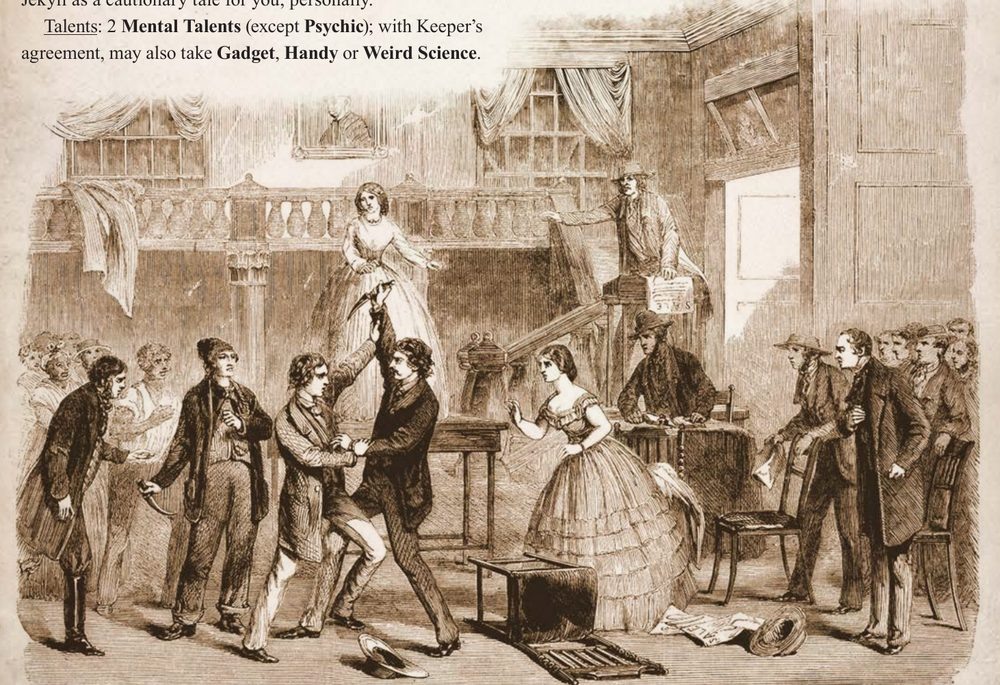

## Пульп-таланты

В этой кампании можно брать любые пульп-таланты, перечисленные в книге сыщика эпохи Газового света. Но для особенно готического духа попробуйте выбрать таланты набором, собранным вокруг готической темы, одним из следующих способов.

### Физический феномен

Вы способны на огромные подвиги силы и выносливости, но вам трудно общаться и выражать себя, а незнакомцев часто пугает ваша внешность. Вы почувствовали укол сочувствия, узнав о несчастном создании доктора Франкенштейна, неотъемлемой части истории основания Книжного клуба.

Таланты: обязательно **«Грозный вид»** (**прочий талант**) и один физический талант (кроме **«Сладкоречивости»**); с согласия Хранителя можно взять также **«Тяжёлую руку»** или **«Ловкий манёвр»**.

### Противоестественный философ

Ваша преданность науке и открытиям не знает равных. Возможно, она и нездорова. Случившееся с доктором Джекилом вы восприняли как предостережение лично вам.

Таланты: два **ментальных таланта** (кроме **психического**); с согласия Хранителя можно взять также **«Изобретение»**, **«Мастера на все руки»** или **«Странную науку»**.

### Одинокий страдалец

Вечно снаружи, вечно заглядывая внутрь, вы изгнали себя из общества из-за настоящего или мнимого изъяна: мрачного и меланхоличного нрава, медленной изнуряющей болезни или невыносимого стыда. Трагические герои готических романов говорят с вашим кислым, иссыхающим сердцем.

Таланты: любые два, но рекомендуется **«Психическая сила»**, а также любой талант, подходящий к обострённым чувствам или величественной меланхолии, — **«Ночное зрение»** или **«Острый слух»** (физические), **«Тайное знание»** (ментальный) или **«Тень»** (прочий).

### Знаток оккультного

Вы много времени провели среди чудовищ, тёмного колдовства и других опасных путей и жаждете поделиться узнанным. Вы узнаёте себя в таких персонажах, как доктор Мартин Хесселиус — оккультный сыщик, расследовавший дело вампира Кармиллы.

Таланты: один **боевой талант**, один **физический** или **ментальный** и один **прочий**.

