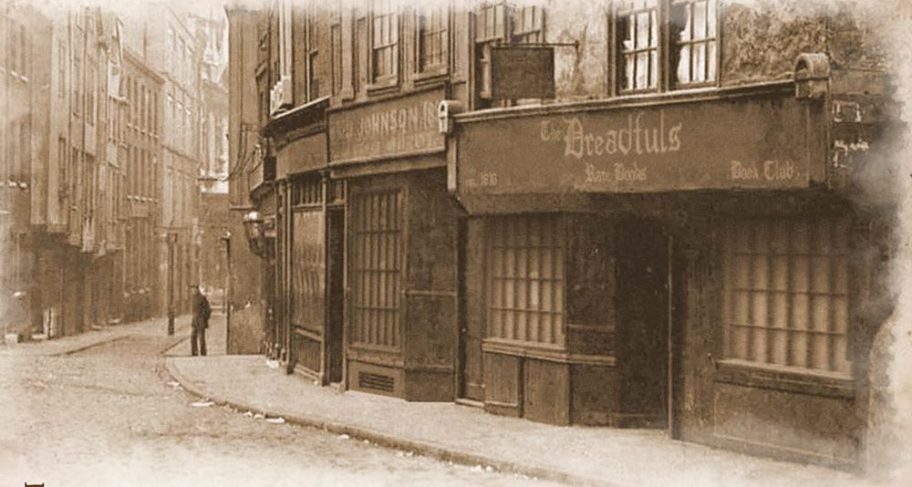

# Ужастики: организация сыщиков

Сыщики «Готики газового света» могут происходить из любых слоёв общества и быть любой профессии. Но все они — члены лондонского светского клуба, известного как Книжный клуб; публика зовёт всех его членов вместе Ужастиками.

## История и члены клуба

В июне 1816 года, в «год без лета», пятеро человек укрылись на вилле Диодати на берегу Женевского озера. Запертые не по сезону холодной погодой и дождём, пятеро поэтов и писателей рассказывали друг другу готические страшные истории. Две из этих историй со временем стали классикой литературы ужасов: «Вампир» Джона Полидори и «Франкенштейн» Мэри Шелли.

Они не были чистым вымыслом. В каждой из историй, рассказанных на той вилле, было зерно правды — о том, с чем авторы и поэты сталкивались сами. Книги были их попыткой осмыслить увиденное… и предостеречь других завуалированным, зашифрованным языком.

Вернувшись в Англию в сентябре 1816 года, Мэри и Перси Биши Шелли через посредников устроили светский клуб — один из множившихся в Лондоне клубов такого рода. Назвали его попросту Книжным клубом, и с тех пор его скромное, тихое здание уютно стоит среди книготорговцев и печатников лондонской Патерностер-роу.

Шелли задумывали клуб как место, где те, кто соприкоснулся с потусторонним, могли бы встречаться, обмениваться историями и узнавать, какие ещё чудовища таятся в тени. Первое десятилетие эти истории держались в строжайшей тайне: в них были скрытые и опасные истины ужасного космоса.

Перси Биши Шелли погиб в 1822 году — утонул вместе с лордом Байроном и другими, когда их лодку застиг шторм. Его несгоревшее сердце уцелело при кремации и стало драгоценным сокровищем Книжного клуба: ему отведено почётное место в закрытой библиотеке клуба.

После его смерти Мэри Шелли продолжала набирать членов в клуб, поддерживая его издали, пока её собственная литературная судьба то возносилась, то шла на спад. К 1830-м годам клубу понадобились деньги. По настоянию Мэри Шелли члены клуба осторожно взялись превращать тайные истории, которые рассказывали друг другу, в несколько приглаженные версии, которые можно было записать и продать любопытной публике.

Члены клуба писали книги сами или нанимали писцов, чтобы те излагали пережитое как вымысел и фантазию. Клуб печатал их на небольшом станке прямо в здании и начал продавать в маленькой книжной лавке при клубе. Дешёвые в печати, дешёвые в продаже, кричащие и непристойные, их истории стали известны как «грошовые ужастики». А члены клуба, в свою очередь, стали известны как Ужастики.

