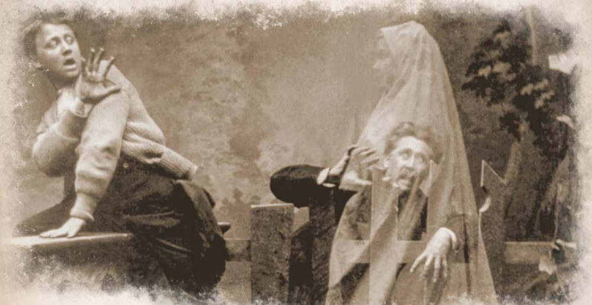

## Призраки клуба

Одно из того, что отличает Книжный клуб от прочих лондонских клубов, — несомненное присутствие в нём нескольких привидений, призраков и иных странностей. Поэтому клуб — излюбленная цель визитов спиритуалистов и тех, кто хочет заглянуть за завесу или доказать, что всё это сплошной вздор.

Многие возможные гости предлагали клубу крупные пожертвования за возможность изучить призраков или научно их разоблачить. Ужастики придерживаются объявленного правила: не допускать ни наживы на этих явлениях, ни их пристального изучения. За этим стоит невысказанный страх, что такие попытки лишь растревожат их.

Вот несколько примеров странного и необъяснимого:

- *В Главном зале из угла возле Читального зала несёт караул забальзамированное тело **Хэтэуэя Ходжеса**, бывшего Ужастика. Он умер, собирая материал для книги на Оркнейских островах. Судя по всему, его последней волей было, чтобы его тело хранилось в клубе, который он так горячо любил. К несчастью, его лицо застыло в выражении полного ужаса, и бальзамирование не смогло этого исправить. Теперь лицо закрыто вуалью. Тот, кто поднимет вуаль и взглянет на жуткий лик под ней, теряет [0/1] **Рассудка**, если не видел его прежде.*
- *Каждый вечер с 4 до 7 часов **Энн Стерлинг** раскидывается на диване в Читальном зале и громко храпит. Она спит под портретом в честь её звания основательницы клуба, где отмечено, что она умерла в 1837 году. По её просьбе её прах хранится в одной из ножек дивана. Никому ещё не удавалось разбудить её, но в преданиях Ужастиков говорится, что, если клубу когда-нибудь будет грозить смертельная опасность, она проснётся и позовёт на помощь.*
- *В Комнате для письма всегда слышен **скрип пера**. Всегда. Кое-кто из членов клуба предполагает, что нечто или некто из Запредельного сочиняет там свой главный труд.*
- ***Человек, напуганный до смерти**, шаркает то тут, то там в любой тёмной комнате или углу клуба. Он предпочитает темноту: слышно, как он мягко, но решительно шаркает прочь из любой комнаты, где зажигают газовый рожок. Если у него когда-то и было имя, никто из Ужастиков его не знал, а сам он его забыл. Те, кто с ним сталкивался, рассказывают о расплывчатом лице, но ясных, печальных глазах.*
- *Встретившись с ним взглядом, человек теряет [0/2] **Рассудка**: призрак ищет сочувствия и утешения, которого никогда не сможет по-настоящему ощутить. При провале проверки **Рассудка** сделайте проверку **МОЩ**; если и она провалена, человека захлёстывают сочувствие и печаль, и на 1d6 часов он одержим желанием помочь этому призрачному присутствию. Увы, призрак не знает, что ему нужно, так что ничто не поможет, но сочувственного слушателя он ценит.*
- *Для **Обеденной карги** в столовой всегда оставляют пустое место. На каждой трапезе или банкете какой-нибудь новый член клуба или неосторожный гость садится на её место, прежде чем его успеют остановить. Вскоре после этого незримая сила наступает ему на ногу, толкает локтем в бок или хватает за плечо холодными костлявыми пальцами. Когда карга так является жертве, та видит чёрные глаза, словно две пустоты (потеря 1/1d4 **Рассудка**), и убеждается, что умрёт в течение месяца, хотя такое случается редко.*
