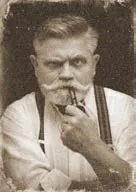
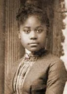
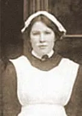
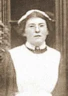
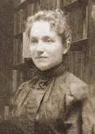
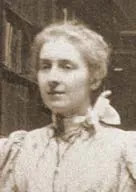
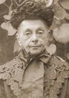

## Персонажи, которых можно встретить в клубе

### Сэмюэл Суонсон

*59 лет, привратник Книжного клуба*

Он служит в клубе столько, сколько все себя помнят, и почти никто не зовёт его иначе, чем «Привратник». Члены клуба, которые зовут его Суонсоном, делают это либо по незнанию, либо из какой-то светской вредности. Обязанность Привратника в клубе — радушно встречать членов клуба, носить их багаж в комнаты и к экипажам и обратно и столь же радушно отваживать нежеланных посетителей. Иногда он также встречает иногородних гостей на одном из лондонских вокзалов. Он высокий, широкоплечий и сильный и вполне подходит для всех своих обязанностей.

### Мисс Ланниган

*28 лет, библиотекарь клуба*

Строгая, деловитая, но страстно любопытная ко всему, что можно узнать из книг. Она сменила прежнего библиотекаря, миссис Уэнлок, которую уволили за то, что та помогла человеку не из клуба получить доступ к некоторым книгам с ограниченным доступом. Мисс Ланниган помнит фонды библиотеки как энциклопедия и неплохо знает историю клуба. Мудрые сыщики обратятся к ней пораньше и почаще.

### Миссис Бикерстафф

*38 лет, экономка*

Приятная и толковая глава прислуги, миссис Бикерстафф тем не менее не всегда отличает своих хозяев от своих подчинённых и не задумываясь раздаёт приказы членам клуба. Она решительно против панибратства между членами клуба и прислугой, да и между самой прислугой, хотя упорный слух гласит, что они с Привратником, возможно, больше чем сослуживцы.

### Миссис Клермонт

*57 лет, кухарка*

Остаётся некоторой загадкой, почему миссис Клермонт занимает место кухарки: её стряпня ни то ни сё, а нрав лучше всего описать словом «кислый». Тем не менее она держится за своё место железной хваткой и знает тысячу мелких способов превратить в ад жизнь любого члена клуба, который жалуется на неё слишком громко. В свободное время её иногда видят возле призрачной Энн Стерлинг: она сидит и тихо говорит со спящей. Но какие отношения связывали или связывают её с покойной соосновательницей клуба, публике неизвестно.

### Эйнсли Рейнольдс

*24 года, начинающая писательница*

Эйнсли уже год околачивается в клубе, пытаясь пробудить интерес к своим странным рассказам и вообще всем надоедая. Добивается ли она договора на издание или членства в клубе, неясно: она ни разу прямо ни о чём не попросила. На открытых мероприятиях клуба она загоняет в угол любого, кто постоит на месте достаточно долго, чтобы рассказать ему о странной книге, которую нашла, или о зловещем человеке в чёрном, говорившем с ней во сне, или о любом другом слегка волнующем событии. Большинство пропускает её слова мимо ушей, но опытные сыщики могут расслышать в её рассказах достаточно правды, чтобы поверить, что она, возможно, и в самом деле столкнулась с Мифами. Можно ли извлечь из этого что-то большее — решать сыщикам.

### Флоренс Бёрнс

*29 лет, спиритуалистка*

Мисс Бёрнс страстно желает провести в клубе спиритический сеанс. Она слышала слухи о живущих там призраках и не может дождаться, когда с ними свяжется. Она утверждает, что у неё есть машина, способная распознать духовное недомогание у задержавшихся на земле душ усопших, и будет только рада бесплатно показать её членам клуба. Её репутация от этого невероятно выиграла бы. Однако призраки клуба дали понять разными знаками и символами, что не желают иметь с мисс Бёрнс ничего общего. На открытые мероприятия её пускают, но устроить сеанс ей пока не удалось.

### Миссис Ифигения Блессинг

*на вид 65 лет, милая любительница книг*

Миссис Блессинг — второе «я» Графини (см. выше). В этом обличье она время от времени посещает открытые мероприятия клуба, обменивается с членами клуба остроумными и слегка неприличными шутками и тактично вынюхивает, какие книги или предметы силы могут быть у Ужастиков. Ещё до начала кампании ей удалось склонить прежнего библиотекаря переписать для неё часть книги Мифов, но клуб так и не узнал, что за этим стояла миссис Блессинг.
