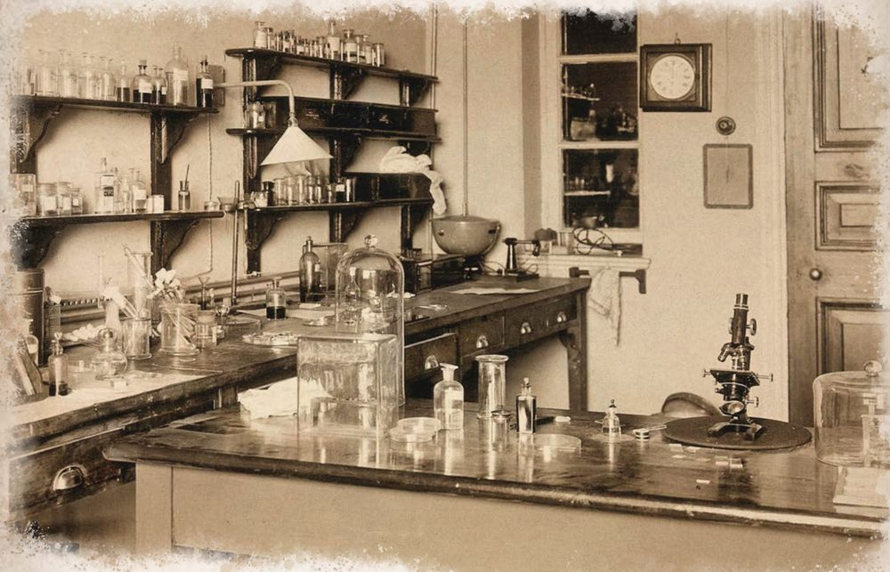

# Глава 2. Прятки с Хайдом (1886)

## Введение

Март 1886 года. Лондон тонет в дождях, слепнет от тумана и задыхается от горящего угля; эхо жутких убийств, совершённых печально известным убийцей Эдвардом Хайдом, всё ещё слышно, хотя с их страшного начала прошло лишь несколько коротких месяцев. После загадочной смерти Хайда, а с ним и его покровителя, доктора Генри Джекила, в Сохо воцарился зыбкий покой: все уверены, что опасность миновала и такие ужасы больше не посетят город. Роберт Льюис Стивенсон, плодовитый член Книжного клуба, превращает эту историю в художественный вымысел, чтобы вынуть из неё жало, а клуб объявил дело закрытым. Но в оккультных кругах ходят шёпотом слухи о причастности Джекила и о странной сыворотке, которая будто бы и породила мистера Хайда. Когда в прежних охотничьих угодьях Хайда обнаруживают череду жестоких убийств, Книжный клуб понимает, что кошмар, возможно, на самом деле вовсе не кончился.

## Предыстория

В 1885 году Лондон был потрясён известием о жестоком избиении и убийстве всеми любимого филантропа и члена парламента сэра Дэнверса Кэрью человеком злобной наружности, известным лишь как Эдвард Хайд. Адвокат по имени Джон Габриэл Аттерсон обнаружил связь Хайда со своим другом и клиентом, доктором Генри Джекилом, и решил выяснить, какую власть злобный Хайд имеет над кротким доктором, но опоздал. Вместе с преданным старым дворецким доктора Джекила, Александром Пулом, он ворвался во врачебный кабинет Джекила в погоне за Хайдом — и нашёл Джекила мёртвым, покончившим с собой, в тот миг, когда он превращался обратно из существа, известного как Хайд. Из бумаг Джекила, в том числе из его завещания, Аттерсон узнал о научных попытках Джекила создать сыворотку, которая отделила бы от тела человека его «злую природу», оставив лишь доброе и чистое. Так родился Хайд, которому дали волю бесчинствовать по Лондону в приступах чистой ярости и жестокости, а Джекил всё хуже владел этим существом, пока последнее убийство не довело дело до развязки. Аттерсон и Пул уничтожили сыворотку и библиотеку доктора — медицинские сочинения и старинные книги, — а Аттерсон сообщил о случившемся Книжному клубу в надежде, что там сумеют всё замять.

*Прим. перев.: здесь в оригинале «John Gabriel Utterson»; на с. 15 и 20 — «Gabriel John Utterson» (Габриэл Джон Аттерсон), как и в базе.*
