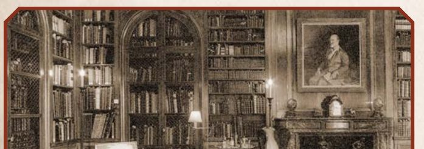
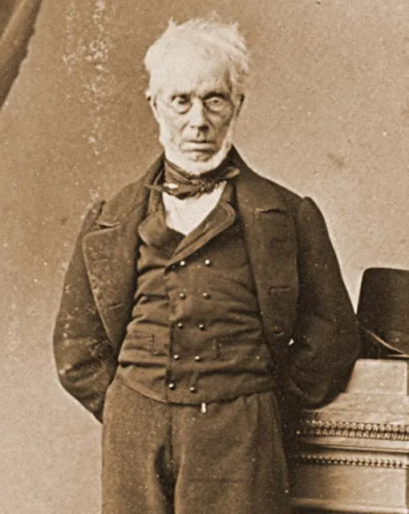

Зацепки для отыгрыша: когда Люси уговорят впустить Ужастиков, она охотно расскажет им, что случилось. Она была привязана к Агнес и хочет, чтобы убийство поскорее раскрыли, поэтому расскажет сыщикам всё, что знает, если они не будут её пугать или злить.

## Прочие персонажи

**Агнес Поттер**
Горничная семьи Мортимер, видевшая, как первый Хайд убил сэра Дэнверса Кэрью, что привело к самоубийству Хайда/Джекила. Её убийство — завязка истории.

**Билли Джонсон**
«Бобби», которому поручено не подпускать зевак к месту убийства.

**Инспектор Гарри Райт**
Сыщик Скотленд-Ярда, ведущий расследование дела этого серийного убийцы.

**Джозеф Лэньон**
Брат доктора Хасти Лэньона; жертва убийства.

**Оскар Андерсон**
Отец девочки из книги; жертва убийства.

**Милли Кэннинг**
Бывшая кухарка Джекила, ненавидевшая Хайда; жертва убийства.

**Инспектор Ньюкомен**
Инспектор, первым ведший дело Хайда; может появиться, а может и нет.

**Фанни Пирсон**
Кухарка и горничная Аттерсона.

**Газетчики**
Толпятся у дома Мортимеров, пытаясь попасть внутрь или разузнать хоть что-нибудь ещё об убийстве.

**Суонсон**
Привратник Книжного клуба, решающий, кого куда пускать.

**Мисс Ланниган**
Строгая, деловитая новая библиотекарша и составительница каталога Книжного клуба.

*Прим. перев.: в оригинале здесь опечатка «Anges Potter»; правильно — Agnes (Агнес).*

## Противники

### Александр Пул

*79 лет, преданный дворецкий Джекила, ныне Хайд II*

*Пул в душе хороший человек, который пошёл совсем не тем путём, пытаясь очистить имя хозяина.*

Внешность Пула: высокий и нескладный, двигается крайне медленно, кости явно скрипят. На вид очень стар, но одет и причёсан безупречно, как и подобает хорошему дворецкому.

Внешность Хайда II: ростом больше 7 футов (свыше 2 м), невероятно широкий и громоздкий. Движется невероятно быстро и жестоко силён.

Черты Пула: со всеми держится вышколенно и безукоризненно. Горячо рассказывает, каким хорошим человеком был его покойный хозяин и что тот не виноват в том, что всё пошло не так.

Черты Хайда II: Хайд II — существо чистого насилия и ярости. Он едва ли способен говорить и крушит всё и всех на своём пути, когда Пул теряет ту малую власть над собой, что у него есть.

Зацепки для отыгрыша: Пул обращается с сыщиками с безукоризненной вежливостью, как с людьми выше его по положению, — пока его не позовут поговорить о покойном докторе Джекиле. Говоря о покойном хозяине, он всё больше волнуется и, если на него надавить, может совсем сломаться. Хайд II просто пытается убить сыщиков как можно более зверски.
