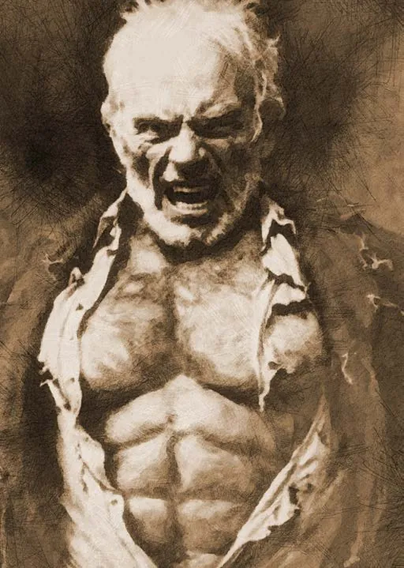

# Акт III. Кто не спрятался

Сыщики могут пойти по одному из двух путей.

**Вариант A.** Решив, что следующая цель — Аттерсон, сыщики могут ночью устроить засаду у его дома. Если они пройдут нужные проверки, то успеют остановить нового Хайда и погонятся за ним сквозь грозовую ночь обратно к кабинету Джекила. Там он переступает кровавые символы на дверном косяке и снова становится Пулом: в отчаянии тянется к своим настойкам и твердит, что «она» может его спасти и что он лишь хотел доказать правоту Джекила и очистить его имя. Он явно теряет власть над Хайдом II и снова начинает превращаться в громадного зверя (1/1d8 **Рассудка**). Когда Хайд II нападает, успешная проверка **Слуха** позволяет сыщикам расслышать под рёвом Хайда голос Пула: он молит о помощи и кричит «ей», чтобы она это прекратила.

**Вариант B.** Сыщики решают отправиться в дом и кабинет Джекила (описание места — в **акте II**). Когда они недолго осмотрят кабинет и найдут кристаллы и сыворотку, дверь распахивается, и входит Пул, весь в крови после убийства Аттерсона; он теряет власть над собой и снова начинает превращаться в Хайда II.

# Эпилог

## Остановить Хайда II

Бой с Хайдом II вряд ли закончится хорошо, если только сыщики не сумеют запереть его в здании и поджечь его. Хайд разрывает на части любого, до кого может дотянуться, а умирающие слышат, как по комнате эхом разносится смех «её». Всякий, кто не замедлит Хайда II или не сумеет сбежать, погибает.

Если сыщикам удастся ввести сыворотку из пробирки в кровь Хайда II — через порез или рану либо влив её ему в рот, — Пул может сделать проверку **МОЩ** с преимуществом (бонусной костью), чтобы вернуть власть над телом. При успехе Хайд II на 1d6 раундов цепенеет, и сыщики могут попытаться убить его или сжечь дом вместе с ним, пока Пул молит о прощении.

> **Примечание для Хранителя**
>
> Любой Ужастик, который примет сыворотку, после того как вдохнул порошок (здесь или в библиотеке), начинает превращаться в третьего Хайда и слышит в голове голос Графини, зовущий его на странном, непонятном ему языке.

## Если Хайда II не остановить

Если сыщики сбегут, не убив и не заперев Хайда II, он продолжит кровавое буйство по Лондону, а затем исчезнет за морем. От Пула не остаётся ничего — только зверь-чудовище. Когда-нибудь Книжному клубу, возможно, придётся иметь с ним дело, но сначала сыщикам предстоит жить с мыслью, что они оставили чудовище на воле в своём городе и что из-за этого, скорее всего, погибнет много людей.

# Награды Рассудка

- **Хайд II остановлен:** +1d6 **Рассудка**.
- **Аттерсон спасён:** +1d4 **Рассудка**.
- **Книга добыта:** +1d4 **Рассудка**.
- **Хайд не остановлен:** −1d8 **Рассудка**.
- **Аттерсон погиб:** −1d4 **Рассудка**.
