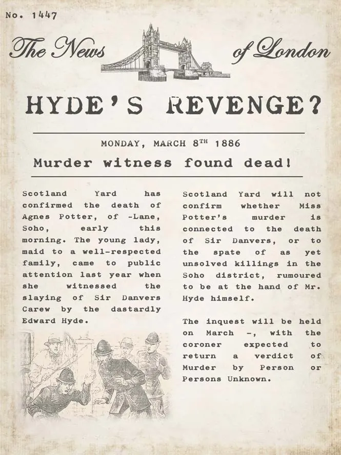

# Раздатки

## Раздатка 1

> **Раздатка 1: «Месть Хайда?»**
>
> № 1447
>
> **НОВОСТИ ЛОНДОНА**
>
> **МЕСТЬ ХАЙДА?**
>
> *Понедельник, 8 марта 1886 года*
>
> **Свидетельница убийства найдена мёртвой!**
>
> Скотленд-Ярд подтвердил смерть Агнес Поттер, проживавшей на …-лейн в Сохо, рано утром сего дня. Молодая особа, горничная в весьма почтенном семействе, привлекла внимание публики в прошлом году, когда стала свидетельницей убийства сэра Дэнверса Кэрью злодеем Эдвардом Хайдом.
>
> Скотленд-Ярд не подтверждает, связано ли убийство мисс Поттер со смертью сэра Дэнверса или с чередой пока не раскрытых убийств в районе Сохо, которые, по слухам, совершил сам мистер Хайд.
>
> Дознание пройдёт … марта; ожидается, что коронер вынесет вердикт «убийство, совершённое лицом или лицами неизвестными».

*Прим. перев.: газета датирована понедельником, 8 марта 1886 года, и сообщает о смерти «рано утром сего дня», а по хронологии сценария Агнес убита 6 марта, а сыщиков вызывают 7 марта; оставлено как напечатано.*
