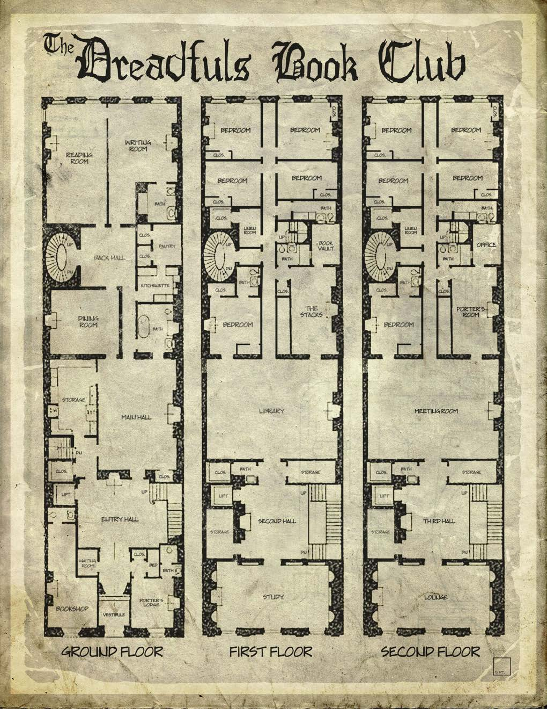

## Раздатка 2

> **Раздатка 2: план Книжного клуба Ужастиков**
>
> *Надпись на плане: «The Dreadfuls Book Club» — Книжный клуб Ужастиков. Три плана: «Ground Floor», «First Floor», «Second Floor» — первый, второй и третий этажи (британский счёт этажей: «First Floor» — наш второй этаж). Масштаб — 5 футов (1,5 м).*

**Ключ**

| Надпись | Перевод |
|---|---|
| **Первый этаж (Ground Floor)** | |
| Bookshop | Книжная лавка |
| Vestibule | Тамбур |
| Entry Hall | Прихожая |
| Waiting Room | Комната ожидания |
| Porter’s Lodge | Привратницкая |
| Main Hall | Главный зал |
| Dining Room | Столовая |
| Back Hall | Задний холл |
| Kitchenette | Кухонька |
| Pantry | Кладовая |
| Reading Room | Читальный зал |
| Writing Room | Комната для письма |
| **Второй этаж (First Floor)** | |
| Second Hall | Холл второго этажа |
| Library | Библиотека |
| Study | Кабинет |
| The Stacks | Хранилище |
| Book Vault | Книжный сейф |
| Bedroom | Спальня |
| **Третий этаж (Second Floor)** | |
| Third Hall | Холл третьего этажа |
| Meeting Room | Зал собраний |
| Lounge | Гостиная |
| Office | Контора |
| Porter’s Room | Комната Привратника |
| Bedroom | Спальня |
| **На всех этажах** | |
| Bath | Ванная |
| Clos. | Чулан |
| Storage | Кладовка |
| Linen Room | Бельевая |
| Lift | Подъёмник |
| Bed | Кровать |

*Прим. перев.: план (раздатка 2) не во всём совпадает с текстом экскурсии по клубу (с. 10–11): на плане нет кухни под столовой и комнат прислуги, Хранилище стоит на втором этаже, а не «в глубине здания на верхнем этаже», есть комнаты, которых нет в тексте. Хранителю лучше следовать тексту экскурсии.*
