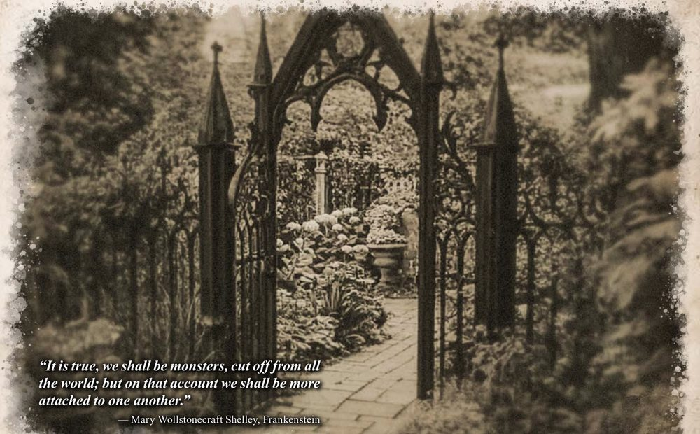

> *«Да, мы будем чудовищами, отрезанными от всего мира; но именно поэтому мы будем ещё сильнее привязаны друг к другу».*
>
> — Мэри Уолстонкрафт Шелли, «Франкенштейн»

# Глава 3. Дитя Франкенштейна (1887)

## Введение

Этот сценарий навеян готическим ужасом «Франкенштейна, или Современного Прометея» Мэри Уолстонкрафт Шелли. Сценарий отступает от сюжета оригинала: в нём невеста Виктора Франкенштейна, Элизабет Лавенца, пережила нападение и бежала от ужасов чудовища Виктора, чтобы тайно родить ребёнка. Ребёнок так и не увидел своего отца.

## Предыстория

«Дитя Франкенштейна» — расследование научного безумия, унаследованного потомком учёного доктора Виктора Франкенштейна. Викторианская публика считает Виктора Франкенштейна плодом воображения Шелли, но Ужастики знают лучше: Франкенштейн существовал, как и его чудовище.

В этом пересказе многое из романа «Франкенштейн, или Современный Прометей» взято прямо из дневника настоящего Виктора Франкенштейна, но часть повествования о браке Виктора Франкенштейна с Элизабет Лавенцей намеренно изменена, чтобы скрыть, кто такие его жена и нерождённый ребёнок. Лавенца, которую будто бы убило Существо в их с Виктором брачную ночь, погибла вовсе не от руки Существа в приступе мести. На самом деле она пережила жестокое нападение и тайно бежала в Англию, где родила сына по имени Адам.

Адам вырос в тени отца, слушая рассказы о Существе и узнавая о первых опытах доктора Франкенштейна на живых животных, которые привели его к оживлению мёртвой человеческой плоти.

Чтобы не запятнать себя репутацией отца и той дурной славой, что сопровождала его опыты, Адам носит девичью фамилию матери, Лавенца, и работает ветеринаром в зоологическом саду Лондиниума. Эта должность позволила Адаму тайно продолжить опыты отца. Однако цель Адама ещё выше, чем была у отца: он стремится не только бросить вызов смерти, но и завладеть силой самих богов. Таинственный покровитель поддерживает его научные начинания, и Адам ближе к цели, чем когда-либо.
