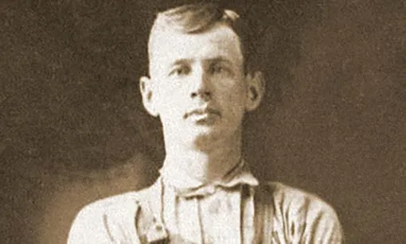
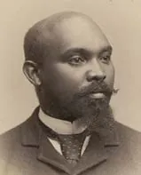

Сценарий начинается 11 мая 1887 года, когда на одном из собраний к Ужастикам обращается Киран Фаулз — племянник Грэма Фаулза, жертвы последнего нападения в зоологическом саду Лондиниума.

Грэм Фаулз не подозревал, что кто-то крадётся за ним по вольерам, когда на него набросился доктор Адам Лавенца в облике химеры Мифов. Несколько подопытных животных, чья природа смешана с природой существ Мифов, присоединились к неистовству и растерзали Грэма Фаулза. Доктор Лавенца ставит эти тайные опыты, чтобы убедиться, что его собственное телесное слияние с биологией Мифов удастся.

## Связь с кампанией

Графиня уже начала вмешиваться в дела Книжного клуба: в погоне за запретным знанием она добилась увольнения прежнего библиотекаря. Теперь она обратила внимание на доктора Лавенцу — тайного сына доктора Виктора Франкенштейна. Действуя из тени, поскольку она всё ещё не желает открывать миру свои большие замыслы, Графиня подталкивает его заниматься наукой, погубившей его отца, и идти ещё дальше.

# Действующие лица

### Киран Фаулз

*19 лет, смотритель черепах в зоосаде Лондиниума*

Нервный юноша, который понимает: если он стучится в двери Книжного клуба и просит помощи у Ужастиков, значит, другого выхода у него уже нет. Его преследует то, что случилось с дядей. Тёмные брови, поношенный рабочий комбинезон и неглаженая рубашка — его вид отражает его душевное состояние.

## Южная больница Сент-Панкрас

### Ронни Риз

*42 года, медсестра*

Сестра Риз — любопытная особа, которая норовит сунуть нос в чужие дела, в том числе и в дела сыщиков, если те её не разубедят. Плотная и резкая на язык, она не терпит дураков.

### Доктор Саймон Пови

*38 лет, терапевт и хирург*

Доктор Пови устал и в недоумении от состояния Грэма Фаулза. Его белый халат измят от долгих смен и множества требовательных пациентов, которым всем нужны его знания.

### Грэм Фаулз

*48 лет, смотритель приматов в зоосаде Лондиниума*

Грэм Фаулз привязан ремнями и верёвками, чтобы не причинить ещё больше вреда себе или другим. Он испытывает сильную боль: его тело разрушается из-за опытов Адама Лавенцы. Он то приходит в сознание, то теряет его, пойманный в кошмаре. Он может рассказать, что с ним случилось, пока воспоминание не станет невыносимым и он снова не провалится в беспокойный сон.

## Зоологический сад Лондиниума

### Доктор Адам Ф. Лавенца / Потусторонняя химера

*50 лет, ветеринар и безумный учёный*

Как сын доктора Виктора Франкенштейна, доктор Лавенца унаследовал безумное желание и почти нечеловеческую жажду заглянуть в мир за пределами нашего. Он нашёл себе место в зоологическом саду Лондиниума: ухитряется держать главного смотрителя сада подальше от своих дел, а прочих служащих использует для поддержки своей работы.

Окружающим он кажется очень умным человеком, преданным своей работе и зоологическому саду Лондиниума. Однако за дверями его тайной лаборатории в пустующем Вольере у канала его настроение меняется: из щедрого и радушного он становится раздражительным, с припадками ярости.

### Бенджамин Сэдлер

*52 года, главный смотритель зоосада Лондиниума*

Заботливый человек, который желает лишь одного — безопасности служащих и животных зоологического сада Лондиниума. Он благодарен, что среди служащих есть такой опытный специалист, как доктор Лавенца. Учитывая слухи о странных делах в зоосаде, главный смотритель Сэдлер мирится с присутствием Ужастиков и их потребностью вести расследование, надеясь лишь, что они остановят то, что крадётся по вольерам, пока не стало слишком поздно.

### Пегги Дин

*21 год, смотритель рептилий в зоосаде Лондиниума*

Всегда готова помочь и добра ко всем служащим, посетителям и животным зоосада Лондиниума. Если кому-то нужен ответ на вопрос или помощь, Пегги Дин с улыбкой готова помочь.

*Прим. перев.: здесь Пегги Дин названа смотрителем рептилий, а на с. 30, 35 и 38 — научной ассистенткой.*
