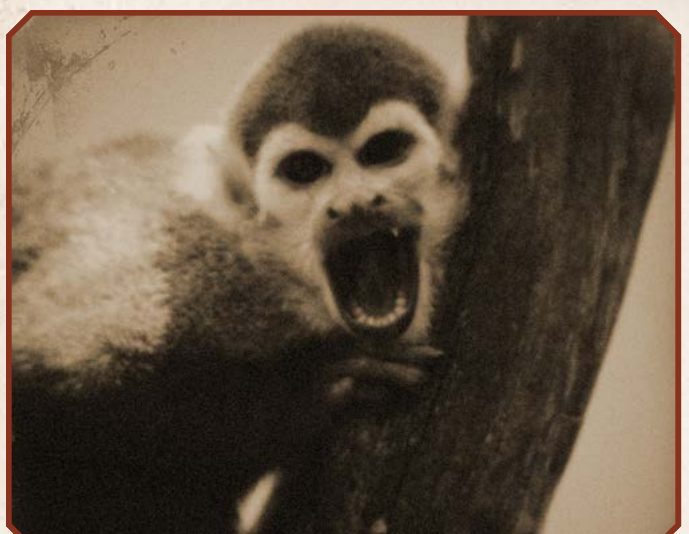

# Как вовлечь сыщиков

Сценарий начинается с того, что смотритель черепах **Киран Фаулз** просит у сыщиков совета и показывает им статью из «Лондиниум пресс» (см. **раздатку 1**).

Очень скоро становится ясно, что с животными в зоосаде творится что-то неладное: там на дядю Фаулза, смотрителя приматов Грэма Фаулза, напали обезумевшие беличьи обезьяны и какое-то крупное неизвестное животное, разгуливающее по саду. Киран Фаулз заметно расстроен, но и нервничает. Успешная проверка **Психологии** показывает, что Киран Фаулз боится за жизнь дяди и не понимает, что за рану тот получил, а мысль о возвращении в зоосад его пугает.

Киран может сообщить следующие дополнительные сведения:

> - Вольер приматов, Обезьяний павильон (12 на карте), был разнесён в клочья — беличьим обезьянам такое не под силу.
> - Восемь из десяти беличьих обезьян в вольере навалились на тело смотрителя Грэма Фаулза, словно защищали его.
> - О присутствии более крупного животного или животных по решению главного смотрителя газетам не сообщили.
> - Когда Киран Фаулз поднял тревогу, прибежал Сэдлер с винтовкой и застрелил двух обезумевших беличьих обезьян снаружи, через решётку вольера.
> - Ветеринар зоосада, доктор Лавенца, распорядился отнести останки беличьих обезьян в лечебницу сада под конторой Зоологического общества (74 на карте). Затем он велел отвезти смотрителя Грэма Фаулза на лечение в Южную больницу Сент-Панкрас.

Под конец Киран Фаулз рассказывает, как полиция бесполезно заявила: «Мёртвых обезьян и взбесившихся зверей не арестуешь, так что нам тут больше делать нечего». Киран Фаулз умоляет сыщиков помочь: все животные в зоосаде напуганы, как и некоторые служащие, а другие животные внезапно умирали или пропадали.

Киран Фаулз не только даёт сыщикам брошюру и карту зоосада (см. **раздатку 2: карта зоологического сада Лондиниума**), но и предлагает отвезти их в Южную больницу Сент-Панкрас к дяде, Грэму Фаулзу, или в Обезьяний павильон зоосада.

Сыщики могут принять предложение Кирана Фаулза или отправиться куда им угодно в своё время.

# Библиотека и читальный зал Книжного клуба

> **Примечание для Хранителя**
>
> Этот раздел предназначен для игры кампанией вместе с другими сценариями этой книги. Он даёт зацепки и улики, связывающие сценарий с главной чародейкой Мифов кампании — Графиней — и её зловещим влиянием на доктора Лавенцу.

Сыщики могут захотеть в разные моменты сценария обратиться к Хранилищу клуба за справками. Например, поговорив с Кираном Фаулзом, они могут захотеть почитать о бешенстве или других необычных маниях у животных, об истории зоосада или даже о крупных хищниках в окрестностях Лондона.

Особых улик здесь не нужно, но, на усмотрение Хранителя, сыщики могут узнать достаточно, чтобы понять: то, с чем они сталкиваются, противоестественно, вряд ли случайно и уж точно тревожно.

## Пропавшая книга

За Хранилищем клуба — его закрытой библиотекой — присматривает сравнительно новая библиотекарша мисс Ланниган, сменившая миссис Уэнлок незадолго до событий «**Пряток с Хайдом**».

Если сыщики обратятся за помощью к мисс Ланниган, она покажется несколько рассеянной: её отвлекает повторяющийся звук. Сыщики могут не обращать внимания на её рассеянность и сразу попросить помощи. Или же они могут помочь ей найти источник загадочного звука в Хранилище.

Если сыщики ведут изыскания, связанные со странными событиями, о которых рассказал Киран Фаулз, пусть сделают проверку **Работы в библиотеке**. Если они попросили помощи у мисс Ланниган, дайте сыщику бонусную кость к проверке **Работы в библиотеке**.

При успешной проверке **Работы в библиотеке** они узнают, что поведение обезьян не похоже ни на один известный случай
