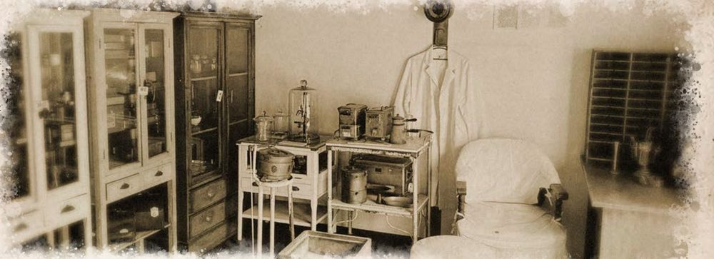

# Акт I. Южная больница Сент-Панкрас (по желанию)

Начать расследование сыщики могут в одном из двух мест. Они могут отправиться в **Южную больницу Сент-Панкрас** к смотрителю приматов Грэму Фаулзу, чтобы справиться о его ранах и расспросить его о случившемся. Или могут пойти в **Обезьяний павильон** зоосада (см. **акт II**).

Южная больница Сент-Панкрас — новая больница, построенная в 1885 году: большое здание красного кирпича с деревянными полами и стенами внутри. Она стоит на Панкрас-роуд в Камдене, Лондон, примерно в 30 минутах ходьбы от зоосада.

Если сыщики придут в Южную больницу Сент-Панкрас вместе со смотрителем черепах Кираном Фаулзом, их сразу, как родственника, пропустят к смотрителю приматов Грэму Фаулзу в его отдельную палату в **отделении F**. Иначе сыщикам придётся выдержать въедливые расспросы сестры Риз за стойкой регистратуры. Сестра спрашивает сыщиков, к кому они пришли и по какому делу. Без Кирана Фаулза, чтобы попасть в отдельную палату Грэма Фаулза в отделении F, нужна успешная проверка **Обаяния**, **Красноречия**, **Запугивания** или **Убеждения**.

При успехе сыщики могут пройти в отделение F без присмотра. При провале сестра Риз зовёт другую сестру подменить её у стойки, чтобы самой проводить сыщиков: она с подозрением относится к их намерениям и думает, что они, возможно, из газеты.

## Отделение F

Голые деревянные стены и полы ведут сыщиков через лабиринт коридоров и извилистых лестниц, мимо снующих туда-сюда медиков. В **палате 312** на третьем этаже можно поговорить с **доктором Саймоном Пови** о состоянии Грэма Фаулза.

Доктор Саймон Пови — мягкая, заботливая душа и специалист по тяжёлым повреждениям тканей и выращиванию мышечных культур. Он ведёт случай Грэма Фаулза и согласует с другими специалистами вопросы о природе яда, возможных противоядиях и переломах костей. Доктор Саймон Пови расскажет следующее:

> - Состояние Грэма — итог невероятно несчастливого стечения обстоятельств: на него напала целая компания разных животных, хотя, по имеющимся сведениям, эти животные не охотятся стаями и обычно не проявляют жестокости. «Конечно, — замечает он, — при подходящих условиях жестоким может стать любое животное».
> - Держа в руках историю болезни Грэма Фаулза, он объясняет, что ткани, кожа и мышцы не только повреждены острыми, но стёртыми орудиями — это говорит о зубах и когтях, — но и явно разорваны чудовищным давлением в разные стороны, что не вяжется ни с одним из хищников, которых держат в зоологическом саду.
> - На бедренной, большеберцовой и плечевой костях видны следы давления, как от клешней-ножниц, — там кости, судя по всему, раздроблены.
> - Он признаёт, что врачи в растерянности. «Разве что несчастного мистера Фаулза покусали змеи, разодрал медведь, а потом на него наступил слон, — иначе его раны просто фантастичны!»

