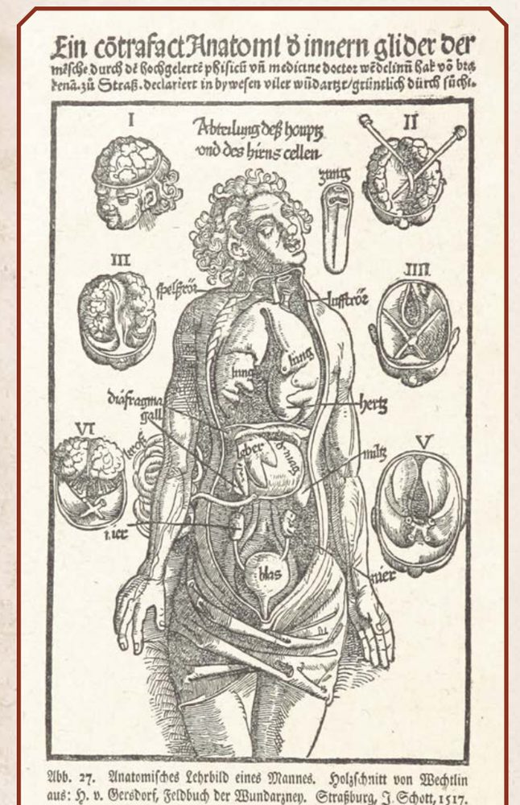
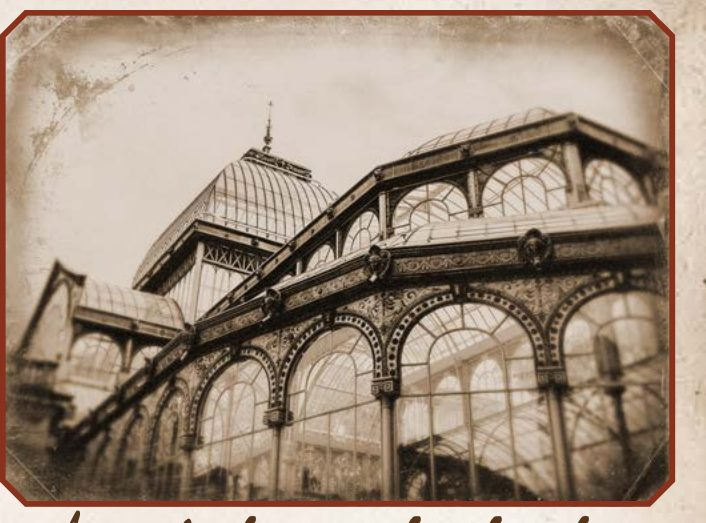

Чтобы узнать о нападении хоть что-то полезное, сыщикам, возможно, придётся успокоить Грэма Фаулза проверкой **Психоанализа** или трудной проверкой **Убеждения**. Без успешной проверки Грэм Фаулз выкрикивает слова и обрывки фраз, как будто бессвязно: *«Руки как ножи… Гавриил… пытались помочь… Голова Михаила, его глаза… Они были прекрасны… Чудовища… Не они… Огромная тень… Что-то другое!»*

При успешной проверке Грэм Фаулз ненадолго приходит в себя. Выгибаясь и рвясь в ремнях, захлёбываясь слюной, он хрипит: *«Его руки — как ножи — Гавриил бросился на меня первым. Я пытался помочь. Там было что-то ещё, не только обезьяны. Что-то большое, свалилось с клетки! Другие обезьяны пытались меня защитить. Это большое чудовище… сказало, что делает работу бога»*.

После этого он теряет сознание, и привести его в чувство больше не удаётся. Если сыщики ещё не побывали в зоологическом саду Лондиниума, им стоит отправиться туда.

# Акт II. Зоологический сад Лондиниума

Сыщики, пришедшие в зоосад, должны получить **раздатку 2** — брошюру с картой сада, где отмечены главные места. Если сыщики приходят к вольеру, не связанному напрямую с событиями сценария, бросьте 1d4 или выберите, как ведут себя животные:

| 1d4 | Поведение животных |
|---|---|
| 1 | Нервничают и прячутся, пристально наблюдая за сыщиками. |
| 2 | Повторяют одни и те же действия — например, раз за разом ходят по одному и тому же пути. |
| 3 | Скуля и плача, лихорадочно ищут, как сбежать из вольера. |
| 4 | Яростно нападают на других животных в вольере — возможно, вплоть до смерти. |

> **Примечание для Хранителя**
>
> Сыщики вряд ли встретят доктора Лавенцу до приближения развязки сценария. Но если он в какой-то момент окажется рядом, описанное выше поведение животных сильно усиливается. Животные так реагируют на Лавенцу, потому что чуют Потустороннюю химеру. Он не только вибрирует на клеточном уровне множеством противоестественных чуждых биологий, но и представляет собой новый вид высшего хищника, стоящего за пределами естественного порядка.

## Обезьяний павильон

Смотритель черепах Киран Фаулз по просьбе сыщиков встречает их у входа в зоосад, если только не приехал вместе с ними. У него есть входные билеты, и он предлагает отвести их к Обезьяньему павильону. Здесь сыщики могут осмотреть место бойни, оставшееся после нападения существа.
