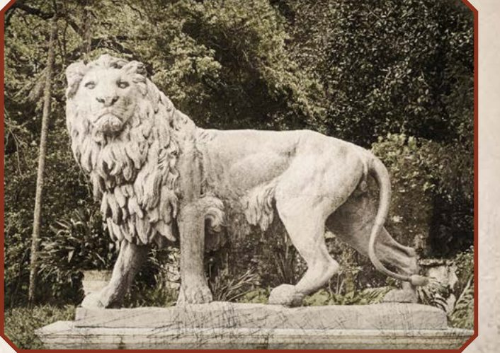

После нападения в саду кое-что произошло, и об этом Кирану и сыщикам рассказывает одна из служащих. Научная ассистентка Пегги Дин, которая весь день убирала обломки в Обезьяньем павильоне, сообщает им:

> - Из **Львиного павильона** (17 на карте) пропал африканский лев по кличке Омари, и где он, неизвестно.
> - Служащие по всему саду боятся за своих животных и за себя, но, похоже, скрывают это от публики.

Обезьяний павильон оцеплен, а на решётки повесили белые простыни, чтобы посетители не видели разрушений. Сыщики, проходящие следующие проверки навыков, могут узнать часть сведений ниже или все:

> **Слух**
>
> - Чем ближе сыщики подходят к Обезьяньему павильону, тем тише становятся животные в саду; они лишь скулят и хнычут.
>
> **Внимание**
>
> - В вольере Обезьяньего павильона — глубокие рваные следы и дыры, от мелких дырочек до крупных яростных царапин.
> - По всему вольеру видны засохшие пятна крови, а там, где нашли Грэма Фаулза, — большое пятно.
> - Три деревянных ящика подтащили к ближайшей стене и поставили друг на друга. Под ними на земле ясно видны следы волочения.

<!-- -->

> **Связь с готической биографией**
>
> Сыщикам с пунктом биографии *«Физический феномен»* может стать не по себе при виде таких масштабов разрушения и жестокости. Может быть, они и сами когда-то теряли власть над собой? Или им приходится постоянно жить среди настороженных людей, которые боятся, что сыщик ненароком их покалечит?

Пегги Дин попросили прибрать вольер, чтобы «не тревожить публику». Наводя порядок, она убрала обломки повреждённого дерева, порванные верёвки и куски потрескавшегося цемента с пола и стен. Она также отнесла последние останки животных, в том числе трупы, доктору Лавенце в **медицинский центр** под **конторой Зоологического общества** (74 на карте).

Поговорив с ней, сыщики могут узнать следующее:

> - В зоосаде есть что-то, чему здесь не место. Его нет в описи, и никто не знает, где оно.
> - Главный смотритель Сэдлер теряет доверие служащих; все напуганы, и работа почти стоит.
> - Среди служащих царит страх, что погибнут ещё животные или пострадают ещё смотрители.
> - Животные чего-то боятся.
> - Прошлой ночью пропал африканский лев Омари. Перед тем доктор Лавенца усыпил Аку, подругу Омари, которая вела себя настороженно и неистово.

<!-- -->

> **Примечание для Хранителя**
>
> Аку, подруга Омари, вела себя настороженно и испуганно, когда доктор Лавенца пришёл будто бы усыпить её. Аку была в ужасе от него и пришла в неистовство, увидев его истинный облик: в облике Потусторонней химеры Лавенца убил Омари и унёс его тело.

## Львиный павильон

Служащие закрыли **Львиный павильон** (место 17 на карте) для публики. Сыщики могут пройти в Львиный павильон под присмотром (или прокравшись). Львица Аку всё ещё в вольере, но усыплена. Если сыщики пришли без смотрителя и хотят осмотреть Аку, им понадобится ключ от главного смотрителя Сэдлера из **конторы Зоологического общества** (место 74 на карте). Для этого нужно правдоподобно объяснить, зачем им в вольер, и пройти проверку социального навыка (или украсть ключ у него проверкой **Ловкости рук**).

