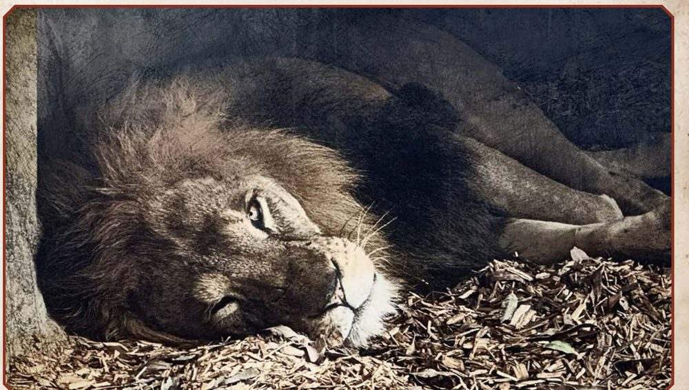

Если сыщики попадут в Львиный павильон, они увидят, что вольер состоит из трёх больших комнат, где львы отдыхают и где их можно посмотреть, когда их не выпускают на открытую площадку. Все три комнаты забраны решётками.

> **Комната 1.** Здесь лежит усыплённая Аку. Если сыщики слишком шумят, Аку начинает шевелиться и может проснуться; заметить это можно только при успешной проверке **Внимания**.
>
> **Комната 2.** При успешной проверке **Внимания** сыщики находят разрыв в решётке там, где прутья загибаются назад, к крыше (примерно в 15 футах, или 4,5 м, от пола).
>
> **Комната 3.** Прутья в этой комнате выломаны, и в решётке зияет дыра около 6 футов (почти 2 м) в поперечнике. Комната теперь пуста, если не считать выброшенной половинки листа, разорванной посередине и скомканной (**раздатка 4: «Искра космической жизни»**), где написано:
>
> *«Есть многое на свете и на небе… Отец был мелочен и ограничен в своих замыслах. Мой безымянный благодетель позволил мне увидеть, что сотворить жизнь просто, но умение взять эту искру и превратить её в пламя разных цветов и температур — это…*
>
> *Я вижу, как мои метафорические бредни проникают в мои исследования, и узнаю в них свою мать. Забранную раньше срока из-за слепого отсутствия честолюбия у отца, скованного своей научной моралью. Удивительно, что он вообще увековечен в той адской книге. «Современный Прометей», надо же! Я — огонь, который он принёс с небес. Я — его наследие! И всё же жалко, что существо, слепленное из собранной грязи, заслужило место в летописях истории, — пусть даже тупая толпа считает его плодом вымысла»*.

*Прим. перев.: текст записки здесь расходится с самой раздаткой 4 (с. 43): там «пламя разных температур и цветов», вместо «Я — огонь, который он принёс с небес» — «Я — его Адам», а второй обрывок записки есть только на с. 43.*

> **Связь с готической биографией**
>
> Сыщики с пунктом биографии «История семьи: падший дом» или «История семьи: большие ожидания» могут почувствовать жутковатое сочувствие к автору этой скомканной записки, узнав, как распад семьи и непосильное давление могут исказить и извратить светлый юный ум.

Сыщики, осматривающие другие части Львиного павильона, могут сделать проверку **Слуха** или **Естествознания** и обнаружить, что, хотя в соседних вольерах почти 40 животных, ни одно из них не издаёт ни звука и не ведёт себя как обычно. Вокруг стоит мёртвая тишина, будто животные боятся хищника.

Если Пегги Дин больше не нужна сыщикам, она извиняется и уходит, объяснив, что должна и дальше помогать доктору Лавенце.
