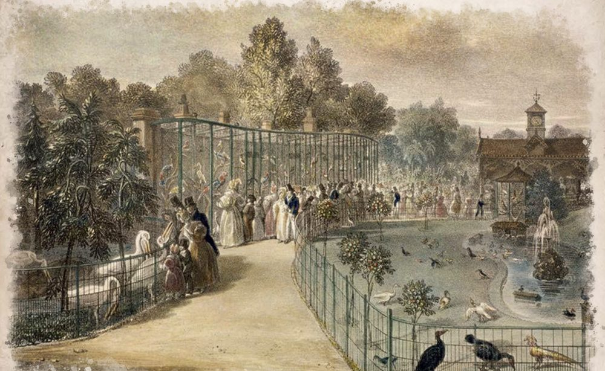

# Акт III. Контора Зоологического общества

Когда сыщики закончат осматривать Обезьяний и Львиный павильоны, главный смотритель Сэдлер шлёт им срочную просьбу. В его записке, которую приносит Пегги Дин (или, если её нет, безымянный служащий зоосада), сказано, что ему известно о связи сыщиков с Книжным клубом и что ему срочно нужны их особые познания.

**Контора Зоологического общества** (место 74 на карте) занимает два этажа. На первом — центральная **приёмная**, **кабинет главного смотрителя** и **бюро находок**. Лестница ведёт вниз, в подвал, где расположены **кабинет ветеринара** (доктора Лавенцы) и **медицинский центр** с операционной и мертвецкой.

Сыщиков проводят в **кабинет главного смотрителя**, прежде чем пустить в остальные помещения конторы.

## Кабинет главного смотрителя

Главный смотритель Сэдлер стоит у большого окна с видом на сад. Когда сыщики входят, он взволнованно оборачивается и приветствует их, излучая тревожное воодушевление. Он уточняет, что сыщиков привёл смотритель черепах Киран Фаулз.

Во время дальнейшего разговора сыщики видят, что на спинке его кресла висят коричневая кожаная кобура и ремень с 12 патронами в маленьких петлях по всей длине; из кобуры торчит револьвер.

Сэдлер просит сыщиков о помощи и объясняет, что происходит:

> - Примерно четыре месяца животные напуганы и ведут себя иначе. Служащим приходится быть осторожными во время кормления и уборки.
> - Животные пропадали или внезапно умирали без всякой причины. Доктор Лавенца пытается выяснить, что происходит, и, к счастью, изо всех сил не допускал, чтобы смерти и исчезновения попали в газеты, оберегая **зоосад**.
> - Журналист «Лондиниум таймс» мистер Скотт Досуэлл несколько дней назад что-то здесь вынюхивал. Он написал заметку об **Обезьяньем павильоне**, но с тех пор его никто не видел.

*Прим. перев.: здесь газета названа «Londinium Times» («Лондиниум таймс»), а в раздатке 1 (с. 40) — «The Londinium Press» («Лондиниум пресс»).*
