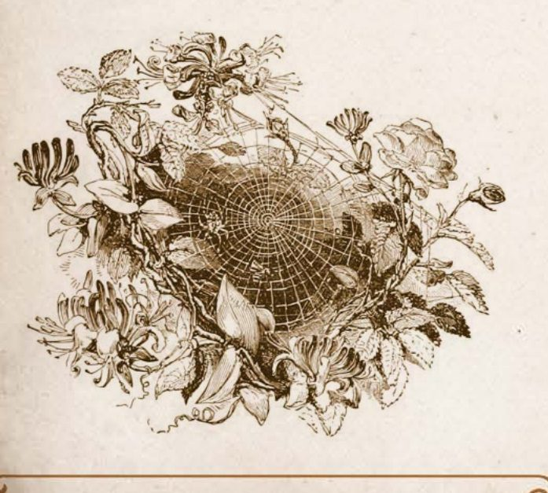

# Персонажи Хранителя

## Южная больница Сент-Панкрас

### Ронни Риз

*42 года, медсестра*

Эти же характеристики годятся для любой медсестры Южной больницы Сент-Панкрас.

```stat
СИЛ 50    ВЫН 70    ТЕЛ 60    ЛВК 60    ИНТ 80
НАР 55    МОЩ 60    ОБР 75    Рассудок 60   ПЗ 13
БкУ: 0    Комплекция: 0   Скорость: 8    ПМ: 12

БОЙ
Ближний бой (драка)   25% (12/5), урон 1d3
Уклонение             30% (15/6)

Навыки: Средства 25%, Первая помощь 50%, Родной язык (английский) 60%, Иностранный язык (лондонский кокни) 20%, Слух 55%, Медицина 55%, Убеждение 65%, Психология 35%, Утешение 55%, Внимание 65%.
```

### Доктор Саймон Пови

*38 лет, терапевт и хирург*

Эти же характеристики годятся для любого врача или хирурга Южной больницы Сент-Панкрас.

```stat
СИЛ 60    ВЫН 60    ТЕЛ 45    ЛВК 70    ИНТ 85
НАР 50    МОЩ 60    ОБР 70    Рассудок 60   ПЗ 10
БкУ: 0    Комплекция: 0   Скорость: 9    ПМ: 12

БОЙ
Ближний бой (драка)   20% (10/4), урон 1d3
Уклонение             35% (17/7)

Навыки: Средства 40%, Первая помощь 55%, Родной язык (английский) 75%, Иностранный язык (латынь) 50%, Слух 35%, Медицина 65%, Убеждение 45%, Психология 40%, Утешение 40%, Наука (биология) 70%, Наука (хирургия) 65%, Внимание 45%.
```

### Грэм Фаулз

*48 лет, смотритель приматов в зоологическом саду Лондиниума*

Текущие характеристики — после отравления Потусторонней химерой.

```stat
СИЛ 25    ВЫН 20    ТЕЛ 60    ЛВК 20    ИНТ 65
НАР 15    МОЩ 65    ОБР 65    Рассудок 32   ПЗ 4
БкУ: 0    Комплекция: 0   Скорость: 2    ПМ: 13
```

*Прим. перев.: так в оригинале — при СИЛ 25 и ТЕЛ 60 БкУ и Комплекция по правилам были бы −1; ПЗ 4 (по ВЫН и ТЕЛ — 8) и Скорость 2 (по характеристикам — 6), видимо, отражают раны и яд.*

Обычные характеристики — если он оправится от отравления Потусторонней химерой.

```stat
СИЛ 70    ВЫН 75    ТЕЛ 60    ЛВК 75    ИНТ 65
НАР 60    МОЩ 65    ОБР 65    Рассудок 52   ПЗ 13
БкУ: +1d4   Комплекция: 1   Скорость: 9    ПМ: 13

БОЙ
Ближний бой (драка)   25% (10/4), урон 1d3
Уклонение             25% (12/5)

Навыки: Обращение с животными 65%, Обаяние 45%, Лазание 55%, Средства 30%, Родной язык (английский) 60%, Иностранный язык (лондонский кокни) 35%, Слух 60%, Взлом 30%, Естествознание 45%, Утешение 36%, Верховая езда 40%, Внимание 65%, Метание 60%.
```

*Прим. перев.: так в оригинале — доли «25% (10/4)»; для 25% должно быть 12/5.*



## Зоологический сад Лондиниума

### Бенджамин Сэдлер

*52 года, главный смотритель зоологического сада Лондиниума*

```stat
СИЛ 60    ВЫН 55    ТЕЛ 55    ЛВК 70    ИНТ 85
НАР 55    МОЩ 60    ОБР 55    Рассудок 49   ПЗ 11
БкУ: 0    Комплекция: 0   Скорость: 9    ПМ: 12

БОЙ
Ближний бой (драка)   25% (12/5), урон 1d3
Уклонение             55% (27/11)

Навыки: Бухгалтерское дело 45%, Обращение с животными 65%, Обаяние 55%, Лазание 40%, Средства 40%, Родной язык (английский) 55%, Слух 60%, Естествознание 60%, Убеждение 55%, Психология 35%, Верховая езда 60%, Наука (биология) 20%, Внимание 45%.
```

### Пегги Дин

*21 год, научная ассистентка зоологического сада Лондиниума*

```stat
СИЛ 45    ВЫН 45    ТЕЛ 60    ЛВК 50    ИНТ 65
НАР 45    МОЩ 75    ОБР 75    Рассудок 75   ПЗ 10
БкУ: 0    Комплекция: 0   Скорость: 4    ПМ: 15

БОЙ
Ближний бой (драка)   25% (10/4), урон 1d3
Уклонение             25% (12/5)

Навыки: Обращение с животными 57%, Обаяние 35%, Лазание 30%, Средства 30%, Родной язык (английский) 65%, Слух 70%, Работа в библиотеке 60%, Естествознание 65%, Убеждение 35%, Утешение 24%, Верховая езда 25%, Внимание 45%, Метание 20%.
```

*Прим. перев.: так в оригинале — Скорость 4 (при СИЛ 45, ЛВК 50 и ТЕЛ 60 по правилам 7) и доли «25% (10/4)» (для 25% — 12/5).*
