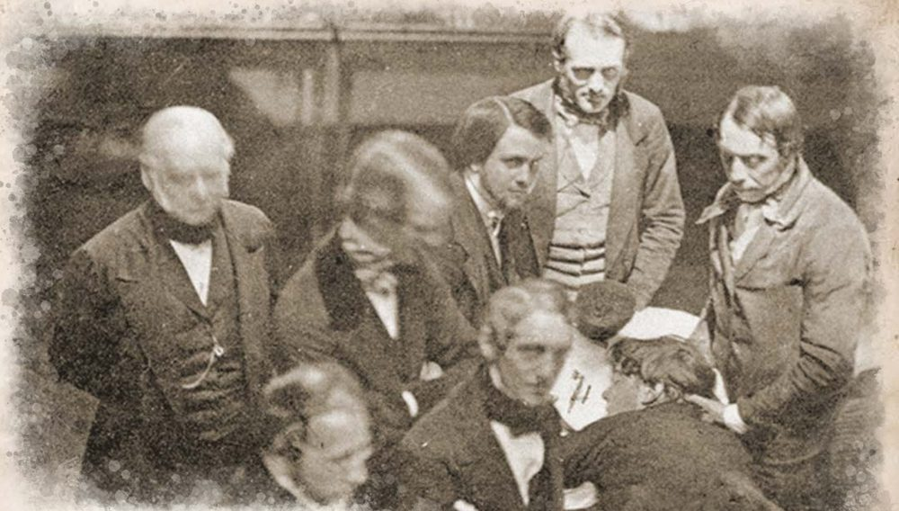

### Доктор Адам Ф. Лавенца / Потусторонняя химера

*50 лет, ветеринар и безумный учёный зоологического сада Лондиниума*

Крупный пятидесятилетний мужчина, носящий своё грузное тело под белым лабораторным халатом. Волосы туго зачёсаны назад, так что кожа на лице натянута. На переносице сидят маленькие круглые тёмные очки. Для такого крупного человека доктор Лавенца снуёт удивительно проворно. Его ум вечно занят тем, чтобы переустроить порядок вещей, но если кто-то привлечёт его внимание, он может сосредоточиться до предела.

Этот затаившийся безумный учёный считает, что извлёк урок из приговоров, вынесенных его отцу, и вовсе не желает, чтобы его труд стал добычей таких, как Мэри Уолстонкрафт Шелли. Доктор Лавенца неустанно трудился, чтобы доказать матери, что достоин продолжить наследие отца и даже выйти за жалкие пределы создания жизни из смерти. Он хочет творить жизнь так, как творил бы бог.

С головой уйдя в работу, он спрятался у всех на виду в зоосаде Лондиниума и обращается с ним как со своей игровой площадкой. Укрывшись в Вольере у канала (84), он хирургически экспериментировал над животными, чудовищами и даже над собой. Теперь он прячет свой непрестанно меняющийся облик под лабораторным халатом и почти ни с кем не общается — разве что с матерью в письмах или со своим таинственным благодетелем. В его глазах он стал сосудом силы многих богов, неведомых человечеству, и поистине держит в руках власть над творением.

**Другие имена:** Дитя Франкенштейна.

```stat
СИЛ 110   ВЫН 80    ТЕЛ 85    ЛВК 75    ИНТ 90
НАР 40    МОЩ 45    ОБР 85    Рассудок —    ПЗ 31
БкУ: +1d6   Комплекция: 2   Скорость: 8 (полёт 10)   ПМ: 8

БОЙ
Атак за раунд: 1 (без оружия)
Ближний бой (драка)   60% (30/12), урон 1d3 + 1d6
Когти                 45% (23/9), урон 1d6 + 1d6
Укус                  60% (30/12), урон 1d4**
Уклонение             40% (20/8)

** Укушенный Потусторонней химерой делает проверку ВЫН, чтобы узнать, отравлен ли он. См. «Действие яда» ниже.

Навыки: Алиенизм 65%, Лазание 75%, Обаяние 25%, Средства 40%, Мифы Ктулху 27%, Родной язык (английский) 93%, Слух 75%, Оккультизм 55%, Наука (биология) 86%, Наука (химия) 65%, Наука (физика) 78%, Внимание 45%, Скрытность 60%.

Потеря Рассудка (при виде Потусторонней химеры): 1d8/2d6+1 пункта Рассудка при встрече с Существом.
```

*Прим. перев.: так в оригинале — Когти 45% (23/9) (половина от 45 — 22); ПЗ 31 при ВЫН 80 и ТЕЛ 85 (по правилам 16, но книга и на с. 37 называет 31 пункт урона — так задумано); ПМ 8 при МОЩ 45 (по правилам 9).*

**Действие яда**

Яд начинает действовать через 1d20 минут:

- немедленная усталость и штрафная кость к любым физическим действиям;
- потеря 1d6 пунктов здоровья каждые 24 часа.
