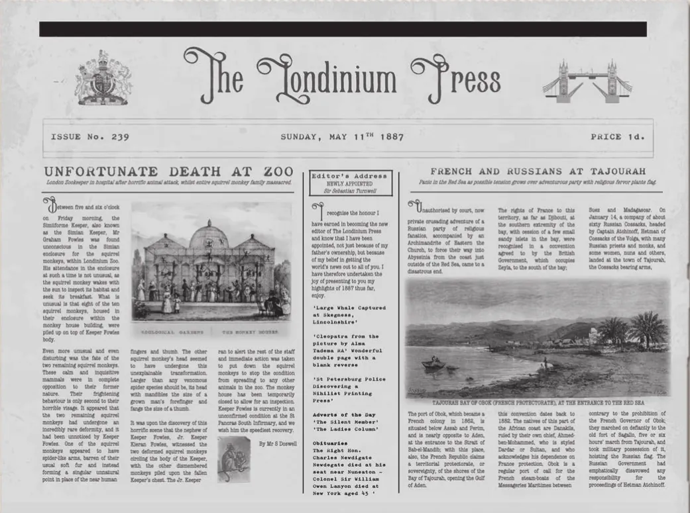

# Раздатки

## Раздатка 1

> **Раздатка 1: «Лондиниум пресс»**
>
> **«ЛОНДИНИУМ ПРЕСС»**
>
> Выпуск № 239 — воскресенье, 11 мая 1887 года — цена 1 пенни.
>
> **НЕСЧАСТНЫЙ СЛУЧАЙ СО СМЕРТЕЛЬНЫМ ИСХОДОМ В ЗООПАРКЕ**
>
> *Лондонский смотритель зоопарка в больнице после ужасного нападения животных; вся семья беличьих обезьян перебита.*
>
> Между пятью и шестью часами утра в пятницу смотритель симиформных, иначе смотритель приматов, мистер Грэм Фаулз был найден без сознания в вольере для беличьих обезьян в зоопарке Лондиниума. Его присутствие в вольере в такой час — дело обычное: беличья обезьяна просыпается с солнцем, чтобы осмотреть своё жилище и поискать завтрак. Необычно другое: восемь из десяти беличьих обезьян, живущих в вольере обезьяньего павильона, лежали грудой на теле смотрителя Фаулза.
>
> *[Картинка: «ЗООЛОГИЧЕСКИЙ САД — ОБЕЗЬЯНЬИ ПАВИЛЬОНЫ»]*
>
> Ещё необычнее и тревожнее участь двух оставшихся обезьянок. Эти спокойные и любознательные млекопитающие повели себя полной противоположностью своей прежней натуре. Их пугающее поведение уступает лишь их ужасному облику. Похоже, две оставшиеся обезьянки перенесли невероятно редкое уродство, которого смотритель Фаулз не заметил. У одной из обезьянок, судя по всему, были паучьи руки, лишённые обычного мягкого меха и сходящиеся в одно противоестественное острие на месте почти человеческих пальцев и большого пальца. С головой другой обезьянки, казалось, произошло то же необъяснимое превращение: больше, чем бывает у любого ядовитого паука, голова с жвалами размером с указательный палец взрослого мужчины и клыками размером с большой палец.
>
> Обнаружив эту ужасную картину, племянник смотрителя Фаулза, младший смотритель Киран Фаулз, увидел, как две изуродованные обезьянки кружат вокруг тела смотрителя, а остальные, растерзанные, лежат грудой на груди упавшего. Младший смотритель побежал поднять тревогу, и немедленно были приняты меры: обезьянок усыпили, чтобы болезнь не перекинулась на других животных зоопарка. Обезьяний павильон временно закрыт для осмотра. Состояние смотрителя Фаулза, находящегося в Южной больнице Сент-Панкрас, пока не сообщается; мы желаем ему скорейшего выздоровления.
>
> *Мистер С. Досуэлл*
>
> **Слово редактора**
>
> *НЕДАВНО НАЗНАЧЕН — сэр Себастьян Тернуэлл*
>
> Я сознаю, какую честь заслужил, став новым редактором «Лондиниум пресс», и знаю, что назначен не только потому, что газета принадлежит моему отцу, но и потому, что верю: новости мира должны доходить до всех вас. Поэтому я с радостью представляю вам главное из 1887 года на сегодняшний день — наслаждайтесь.
>
> «Большой кит пойман в Скегнессе, Линкольншир»
>
> «Клеопатра с картины Альма-Тадемы, члена Королевской академии» — чудесный разворот с чистой оборотной стороной
>
> «Полиция Санкт-Петербурга обнаружила типографию нигилистов»
>
> Объявления дня
>
> «Молчаливый член парламента»
>
> «Дамская колонка»
>
> **Некрологи.** Достопочтенный Чарльз Ньюдигейт Ньюдегейт скончался в своём имении близ Нанитона. — Полковник сэр Уильям Оуэн Лэньон скончался в Нью-Йорке в возрасте 45 лет.
>
> **ФРАНЦУЗЫ И РУССКИЕ В ТАДЖУРЕ**
>
> *Паника на Красном море: растёт напряжение из-за отряда искателей приключений, в религиозном рвении водрузившего флаг.*
>
> Не одобренный двором, а ныне частный крестовый поход русского отряда религиозных фанатиков в сопровождении архимандрита Восточной церкви, пытавшегося силой пробиться в Абиссинию с побережья у самого Красного моря, окончился бедой.
>
> Права Франции на эту территорию вплоть до Джибути у южной оконечности залива, с уступкой нескольких маленьких песчаных островков в заливе, были признаны соглашением, которое подписало британское правительство, занимающее Зейлу к югу от залива; это соглашение восходит к 1882 году. Туземцы этой части африканского побережья — данакили; ими правит собственный вождь Ахмед-бен-Мохаммед, именуемый дардаром, или султаном, который признаёт свою зависимость от французского покровительства. Обок — постоянная стоянка французских пароходов «Мессажери маритим» между Суэцем и Мадагаскаром. 14 января отряд примерно из шестидесяти русских казаков во главе с капитаном Ашиновым, атаманом волжских казаков, со множеством русских священников и монахов, а также несколькими женщинами, монахинями и другими высадился в городе Таджура; казаки были вооружены, вопреки запрету французского губернатора Обока; они дерзко двинулись к старому форту Сагалло, в пяти-шести часах пути от Таджуры, и заняли его военной силой, подняв русский флаг. Русское правительство решительно отреклось от всякой ответственности за действия атамана Ашинова.
>
> *[Картинка: «ЗАЛИВ ТАДЖУРА У ОБОКА (ФРАНЦУЗСКИЙ ПРОТЕКТОРАТ), У ВХОДА В КРАСНОЕ МОРЕ»]*
>
> Порт Обок, ставший французской колонией в 1862 году, лежит ниже Ассаба и Перима, почти напротив Адена, у входа в Баб-эль-Мандебский пролив; отсюда Французская республика притязает и на протекторат, то есть суверенитет, над берегами залива Таджура, открывающего Аденский залив.

*Прим. перев.: в оригинале газета названа «The Londinium Press», а на с. 32 Сэдлер называет её «Londinium Times».*
