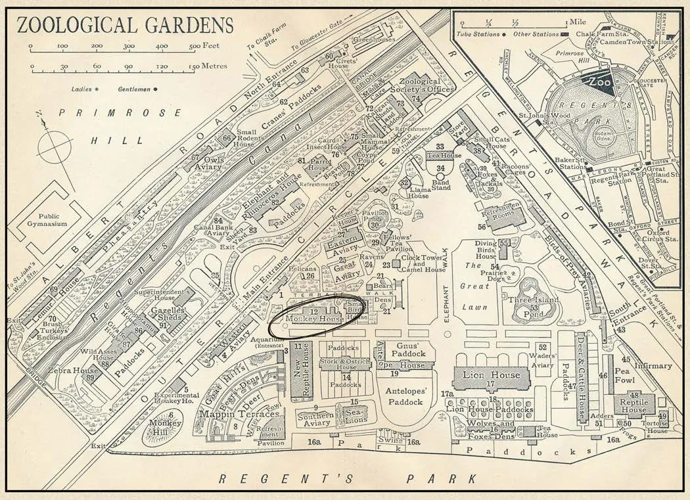

## Раздатка 2

> **Раздатка 2: карта зоологического сада Лондиниума**
>
> *Надпись на карте: «Zoological Gardens» — Зоологический сад. Масштабная линейка: 0–150 м. Знаки уборных: дамские — звёздочка, мужские — точка. Обезьяний павильон (12) обведён от руки.*

**Ключ**

| № | Место |
|---|---|
| 1 | *без подписи* |
| 3 | Аквариум зоосада |
| 4 | Западный вольер |
| 5 | Экспериментальный обезьянник |
| 6 | Обезьянья горка |
| 8 | Террасы Маппина |
| 9 | Южный вольер |
| 11 | Новый павильон рептилий |
| 12 | Обезьяний павильон |
| 14 | Павильон аистов и страусов с загонами |
| 15 | Морские львы |
| 16 | Логова волков и лис |
| 16a | *без подписи* |
| 17 | Львиный павильон |
| 17a | *без подписи* |
| 18 | Загоны Львиного павильона |
| 19 | Павильон антилоп |
| 21 | Медвежьи логова |
| 23 | Часовая башня и павильон верблюдов |
| 24 | Вороны |
| 25 | Большой вольер |
| 26 | Пеликаны |
| 27 | Восточный вольер |
| 29 | Чайный павильон членов Общества |
| 30 | Пруд у павильона |
| 31 | *без подписи* |
| 32 | Павильон лам |
| 33 | Чайный домик зоосада |
| 34 | Эстрада для оркестра |
| 38 | Павильон мелких кошачьих |
| 39 | Лисы и шакалы |
| 41 | Клетки енотов |
| 42 | Вольеры хищных птиц |
| 43 | Южный вход зоосада |
| 45 | Лазарет зоосада |
| 46 | Павлины |
| 47 | Павильон оленей и скота с загонами |
| 48 | Павильон рептилий |
| 49 | Павильон черепах |
| 50 | Лягушки |
| 51 | Гадюки |
| 52 | Вольер голенастых птиц |
| 53 | Пруд Трёх островов |
| 54 | Луговые собачки |
| 55 | Павильон ныряющих птиц |
| 56 | Буфет зоосада |
| 59 | *без подписи* |
| 60 | Павильон циветт |
| 62 | Журавлиные загоны |
| 63 | *без подписи* |
| 64 | *без подписи* |
| 66 | Павильон мелких грызунов |
| 67 | Совиный вольер |
| 69 | Павильон лемуров |
| 70 | Вольер сорных кур |
| 72 | Обезьянья клетка |
| 73 | Сараи и загон кенгуру |
| 74 | Контора Зоологического общества |
| 75 | Павильон мелких млекопитающих |
| 76 | Инсектарий Кэрда |
| 77 | Пруд нутрий |
| 78 | Бобровый пруд |
| 81 | Павильон попугаев |
| 82 | Павильон слонов и носорогов |
| 83 | Овечий двор |
| 84 | Вольер у канала |
| 85 | *без подписи* |
| 86 | Павильон бегемотов |
| 87 | Павильон жирафов |
| 88 | Павильон диких ослов |
| 89 | Павильон зебр |
| 91 | Сараи газелей |

**Прочие подписи:** Примроуз-хилл, Альберт-роуд, Риджентс-канал, Внешний круг, Риджентс-парк, Северный вход, Главный вход, Выход, Дом управляющего, Дом смотрителя, Оранжереи, Мост через канал, Старый тоннель, Западный тоннель, Фазанник, Загоны, Хозяйственный двор, Буфеты, Загон гну, Загон антилоп, Павильон-буфет, Чайный домик, Свиньи, Терраса, Медвежья аллея, Слоновья аллея, Большая лужайка, Общественный гимнастический зал, к станции Чок-Фарм, к Глостерским воротам, к станции Сент-Джонс-Вуд; врезка: Риджентс-парк, зоопарк, станции (метро •, прочие), масштабная линейка.
