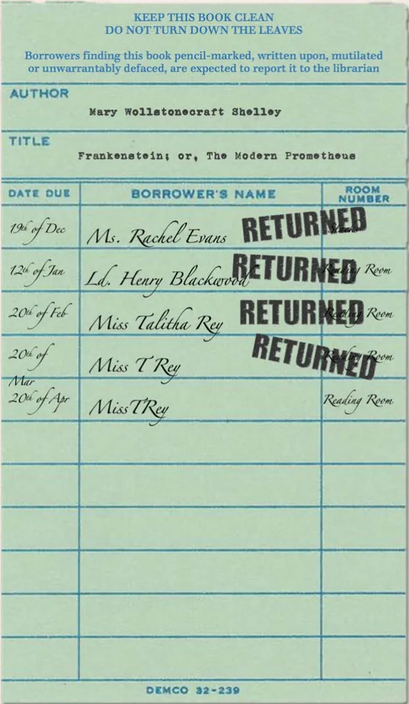

## Раздатка 3

> **Раздатка 3: выброшенный библиотечный формуляр**
>
> СОДЕРЖИТЕ КНИГУ В ЧИСТОТЕ
>
> НЕ ЗАГИБАЙТЕ СТРАНИЦЫ
>
> *Читатели, обнаружившие в книге пометки карандашом, надписи, повреждения или необоснованную порчу, должны сообщить об этом библиотекарю.*
>
> АВТОР: Мэри Уолстонкрафт Шелли
>
> НАЗВАНИЕ: Франкенштейн, или Современный Прометей
>
> | Срок возврата | Имя читателя | Номер комнаты |
> |---|---|---|
> | 19 декабря | мисс Рейчел Эванс — ВОЗВРАЩЕНО | Хранилище |
> | 12 января | лорд Генри Блэквуд — ВОЗВРАЩЕНО | Читальный зал |
> | 20 февраля | мисс Талита Рей — ВОЗВРАЩЕНО | Читальный зал |
> | 20 марта | мисс Т. Рей — ВОЗВРАЩЕНО | Читальный зал |
> | 20 апреля | MissTRey (мисс Т. Рей) | Читальный зал |
>
> DEMCO 32-239

*Прим. перев.: в последней строке имя написано слитно — «MissTRey»; оно складывается в слово «MYSTERY» («тайна»), поэтому оставлено латиницей.*
