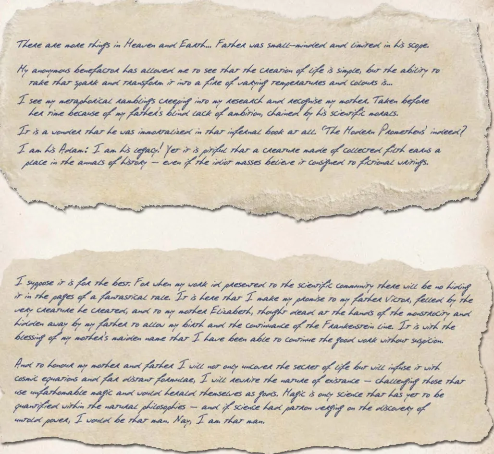

## Раздатка 4

> **Раздатка 4: «Искра космической жизни»**
>
> *Есть многое на свете и на небе… Отец был мелочен и ограничен в своих замыслах.*
>
> *Мой безымянный благодетель позволил мне увидеть, что сотворить жизнь просто, но умение взять эту искру и превратить её в пламя разных температур и цветов — это…*
>
> *Я вижу, как мои метафорические бредни проникают в мои исследования, и узнаю в них свою мать. Забранную раньше срока из-за слепого отсутствия честолюбия у отца, скованного своей научной моралью.*
>
> *Удивительно, что он вообще увековечен в той адской книге. «Современный Прометей», надо же!*
>
> *Я — его Адам: я — его наследие! И всё же жалко, что существо, слепленное из собранной грязи, заслужило место в летописях истории, — пусть даже тупая толпа считает его плодом вымысла.*

<!-- -->

> **Раздатка 4 (второй обрывок)**
>
> *Полагаю, так даже лучше. Ведь когда мой труд будет представлен научному сообществу, его не спрятать будет на страницах фантастической повести. Здесь я даю обещание моему отцу Виктору, сражённому тем самым существом, которое он создал, и моей матери Элизабет, которую считали погибшей от рук чудовища и которую отец спрятал, чтобы я мог родиться и род Франкенштейнов продолжился. Благословлённый девичьей фамилией матери, я смог продолжать благое дело, не вызывая подозрений.*
>
> *И, чтобы почтить мать и отца, я не только раскрою тайну жизни, но и наполню её космическими уравнениями и формулами далёких миров, я перепишу саму природу бытия — бросив вызов тем, кто пользуется непостижимой магией и провозглашает себя богами. Магия — лишь наука, которую ещё не измерили натурфилософией, — и если бы у науки был покровитель на пороге открытия несказанной силы, этим человеком был бы я. Нет — я и есть этот человек.*

*Прим. перев.: текст записки в главе (с. 31) расходится с раздаткой: там «пламя разных цветов и температур» и «Я — огонь, который он принёс с небес. Я — его наследие!», а второго обрывка нет. Здесь — текст раздатки. Описки оригинала («work id presented», «monstrocity», «existance») в переводе не видны. «Есть многое на свете и на небе…» — цитата из «Гамлета».*
