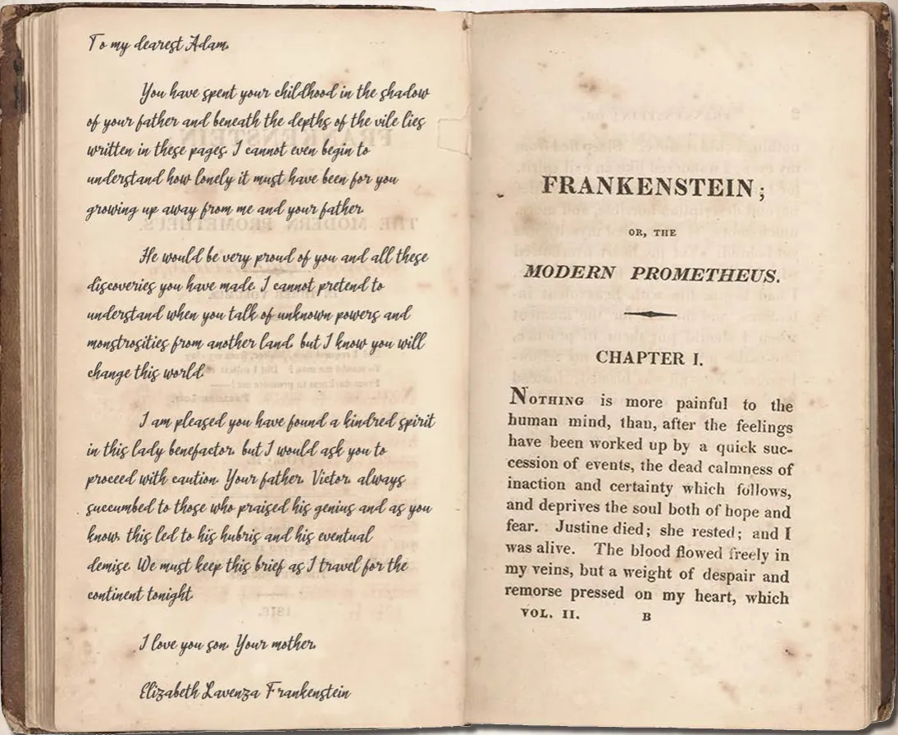

## Раздатка 5

> **Раздатка 5: личная надпись**
>
> *Моему дорогому Адаму.*
>
> *Ты провёл детство в тени своего отца и под толщей гнусной лжи, написанной на этих страницах. Я даже не могу представить, как одиноко тебе было расти вдали от меня и твоего отца.*
>
> *Он очень гордился бы тобой и всеми твоими открытиями. Не стану делать вид, что понимаю, когда ты говоришь о неведомых силах и чудовищах из иного края, но я знаю: ты изменишь этот мир.*
>
> *Я рада, что ты нашёл родственную душу в этой даме-благодетельнице, но прошу тебя быть осторожным. Твой отец, Виктор, всегда поддавался тем, кто хвалил его гений, и, как ты знаешь, это привело его к гордыне и в конце концов к гибели. Буду краткой: сегодня вечером я уезжаю на континент.*
>
> *Люблю тебя, сын. Твоя мать.*
>
> *Элизабет Лавенца-Франкенштейн*
>
> [Напротив — печатная страница:] ФРАНКЕНШТЕЙН, ИЛИ СОВРЕМЕННЫЙ ПРОМЕТЕЙ. ГЛАВА I. Нет ничего мучительнее для человеческого ума, чем, после того как чувства были взвинчены быстрой чередой событий, мёртвое спокойствие бездействия и определённости, которое следует за ними и лишает душу и надежды, и страха. Жюстина умерла; она обрела покой; а я был жив. Кровь свободно текла в моих жилах, но сердце моё давила тяжесть отчаяния и раскаяния, которая… ТОМ II. B
