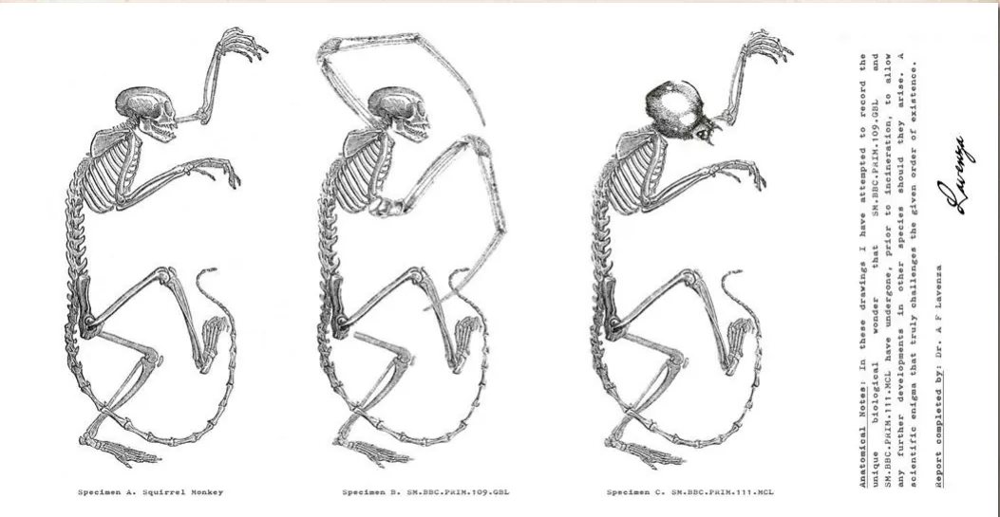
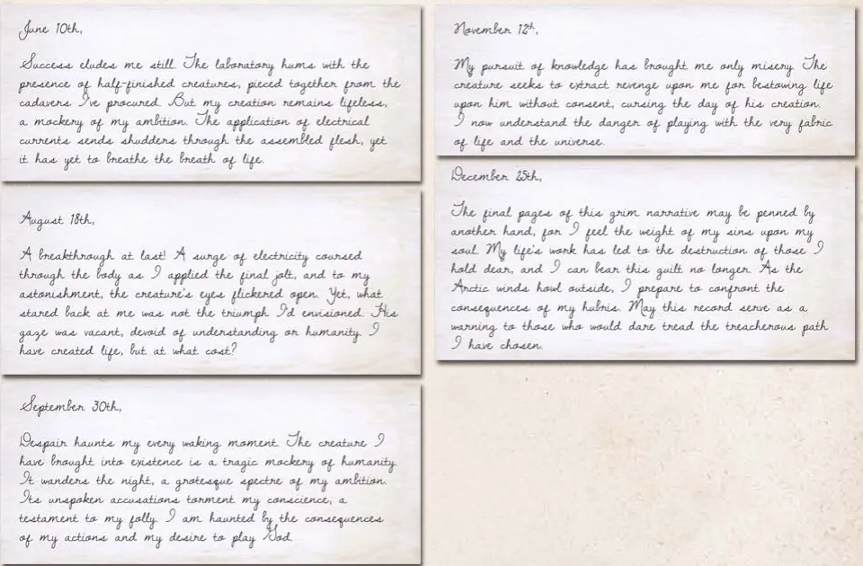

## Раздатка 6

> **Раздатка 6: анатомические отличия**
>
> Образец A. Беличья обезьяна
>
> Образец B. SM.BBC.PRIM.109.GBL
>
> Образец C. SM.BBC.PRIM.111.MCL
>
> *Анатомические заметки:* в этих рисунках я попытался запечатлеть уникальное биологическое чудо, которое претерпели SM.BBC.PRIM.109.GBL и SM.BBC.PRIM.111.MCL, до их сожжения, чтобы можно было проследить дальнейшее развитие у других видов, если оно возникнет. Научная загадка, поистине бросающая вызов заведённому порядку бытия.
>
> Отчёт составил: д-р А. Ф. Лавенца
>
> *[подпись]* Лавенца

## Раздатка 7

> **Раздатка 7: выдержки из дневника Виктора Франкенштейна**
>
> **10 июня.**
>
> *Успех всё ещё ускользает от меня. Лаборатория гудит от присутствия недоделанных созданий, собранных из добытых мною трупов. Но моё творение остаётся безжизненным — насмешка над моими устремлениями. Электрический ток сотрясает собранную плоть, но она так и не сделала первого вдоха жизни.*
>
> **18 августа.**
>
> *Наконец прорыв! Когда я дал последний разряд, по телу пробежала волна электричества, и, к моему изумлению, глаза существа дрогнули и открылись. Но на меня смотрел не тот триумф, что я воображал. Его взгляд был пуст, лишён понимания и человечности. Я создал жизнь — но какой ценой?*
>
> **30 сентября.**
>
> *Отчаяние преследует меня каждое мгновение наяву. Существо, которое я вызвал к жизни, — трагическая насмешка над человечеством. Оно бродит в ночи, гротескный призрак моего честолюбия. Его безмолвные обвинения терзают мою совесть — свидетельство моего безрассудства. Меня преследуют последствия моих поступков и моё желание играть в Бога.*
>
> **12 ноября.**
>
> *Погоня за знанием принесла мне одни страдания. Существо жаждет отомстить мне за то, что я без его согласия даровал ему жизнь, и проклинает день своего создания. Теперь я понимаю, как опасно играть с самой тканью жизни и мироздания.*
>
> **25 декабря.**
>
> *Последние страницы этой мрачной повести, быть может, допишет другая рука, ибо я чувствую на душе тяжесть своих грехов. Труд моей жизни погубил тех, кто мне дорог, и я больше не в силах нести эту вину. Пока снаружи воют арктические ветры, я готовлюсь встретить последствия своей гордыни. Пусть эта запись послужит предостережением тем, кто осмелится ступить на избранный мною коварный путь.*
