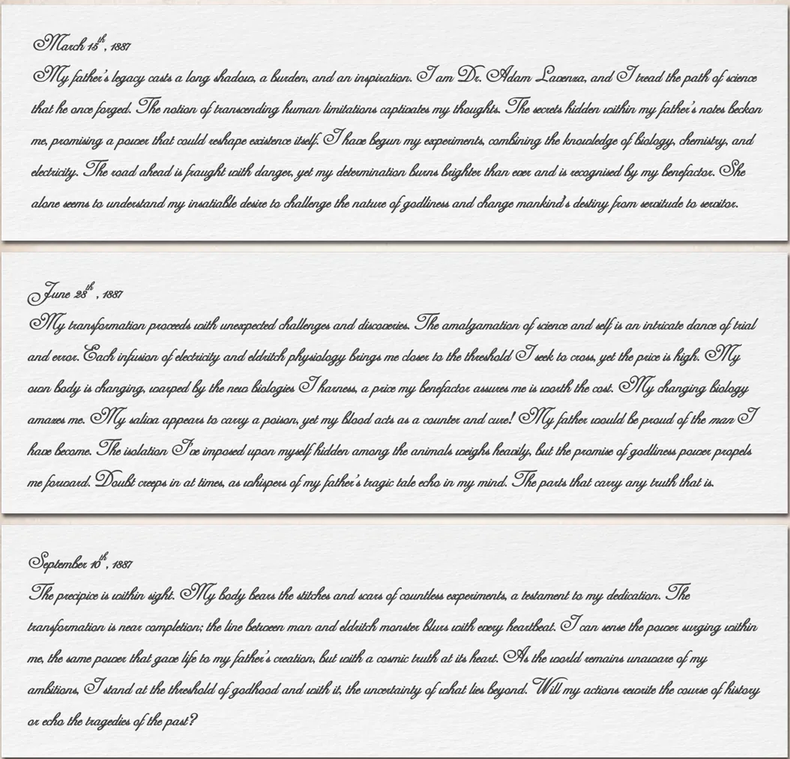

## Раздатка 8

> **Раздатка 8: выдержки из дневника доктора Адама Ф. Лавенцы**
>
> **15 марта 1887 года**
>
> *Наследие отца отбрасывает длинную тень — это и бремя, и вдохновение. Я — доктор Адам Лавенца, и я иду по пути науки, который он когда-то проложил. Мысль о том, чтобы превзойти человеческие пределы, захватывает меня. Тайны, скрытые в записях отца, манят меня, обещая силу, способную перекроить само бытие. Я начал опыты, соединяя знания биологии, химии и электричества. Путь впереди полон опасностей, но моя решимость горит ярче, чем когда-либо, и её признаёт моя благодетельница. Лишь она, кажется, понимает мою неутолимую жажду бросить вызов природе божественности и изменить судьбу человечества — из рабства в господство.*
>
> **28 июня 1887 года**
>
> *Моё превращение идёт, принося неожиданные трудности и открытия. Слияние науки и себя — сложный танец проб и ошибок. Каждое вливание электричества и потусторонней физиологии приближает меня к порогу, который я стремлюсь переступить, но цена высока. Моё собственное тело меняется, искажённое новыми биологиями, которые я обуздываю, — цена, которая, как уверяет благодетельница, того стоит. Меня изумляет моя меняющаяся природа. Моя слюна, похоже, несёт яд, а кровь служит противоядием и лекарством! Отец гордился бы тем, кем я стал. Одиночество, на которое я обрёк себя, укрывшись среди животных, тяготит меня, но обещание божественной силы гонит вперёд. Порой закрадываются сомнения, когда в мыслях отзывается шёпот трагической истории отца. Тех её частей, в которых есть хоть доля правды.*
>
> **10 сентября 1887 года**
>
> *Край пропасти уже виден. Моё тело несёт швы и шрамы бесчисленных опытов — свидетельство моей преданности делу. Превращение почти завершено; грань между человеком и потусторонним чудовищем стирается с каждым ударом сердца. Я чувствую, как во мне бурлит сила — та самая, что дала жизнь творению отца, но с космической истиной в сердцевине. Пока мир не ведает о моих замыслах, я стою на пороге божественности, а с ним — неизвестности того, что лежит за ним. Перепишут ли мои деяния ход истории или повторят трагедии прошлого?*

*Прим. перев.: сценарий начинается 11 мая 1887 года (раздатка 1), а две последние записи дневника датированы 28 июня и 10 сентября 1887 года — позже начала событий. Даты оставлены как в оригинале.*
