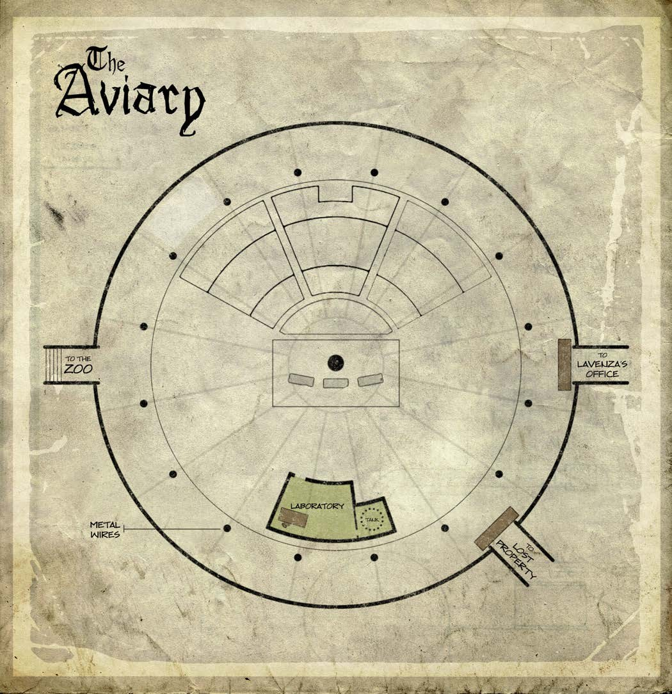

# Карты

## План Вольера у канала

*Надпись на плане: «The Aviary» — Вольер.*

| Подпись на плане | Перевод |
|---|---|
| To the Zoo | В зоосад (вход для публики, заперт на цепь) |
| To Lavenza’s Office | В кабинет Лавенцы (потайной ход в кабинет ветеринара, за портретом Прометея) |
| Laboratory | Лаборатория |
| Tank | Аквариум (для призыва) |
| Metal Wires | Металлические кабели (вдоль сетки купола) |
| To Lost Property | В бюро находок (потайной ход) |

*Без подписи в центре плана — ярусы каменных скамей амфитеатра и сцена.*
