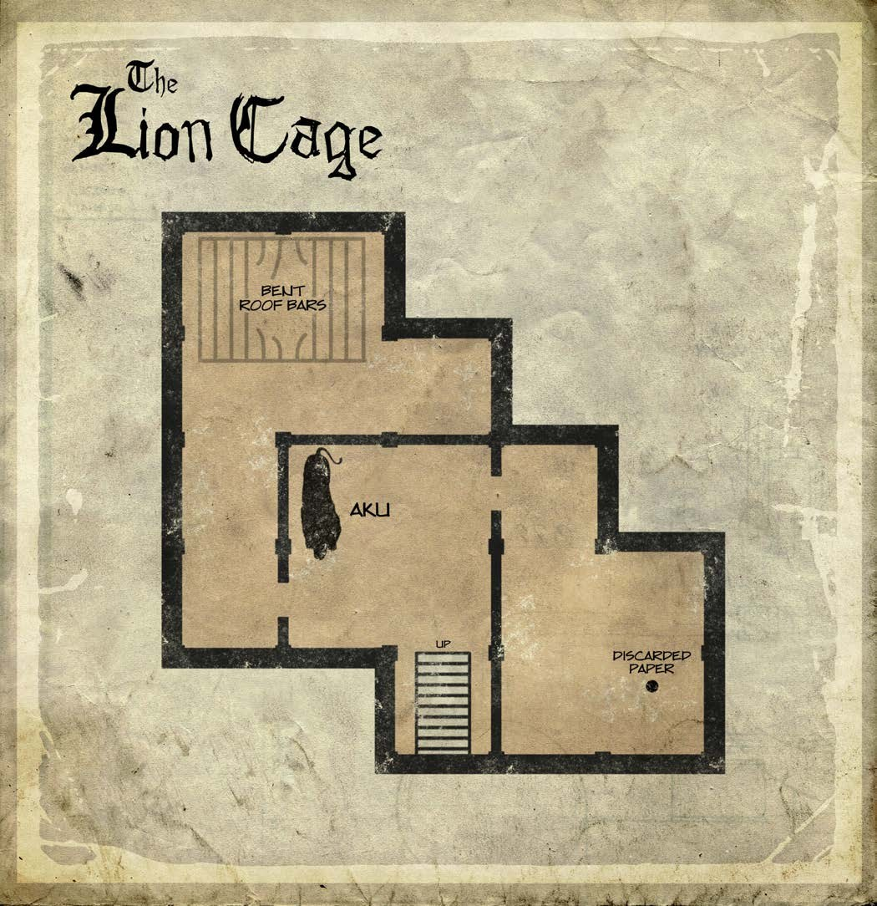

## План Львиного павильона

*Надпись на плане: «The Lion Cage» — Клетка львов.*

| Подпись на плане | Перевод |
|---|---|
| Bent Roof Bars | Погнутые прутья крыши |
| Aku | Аку (лев) |
| Up | Наверх |
| Discarded Paper | Выброшенная бумага (раздатка 4) |
