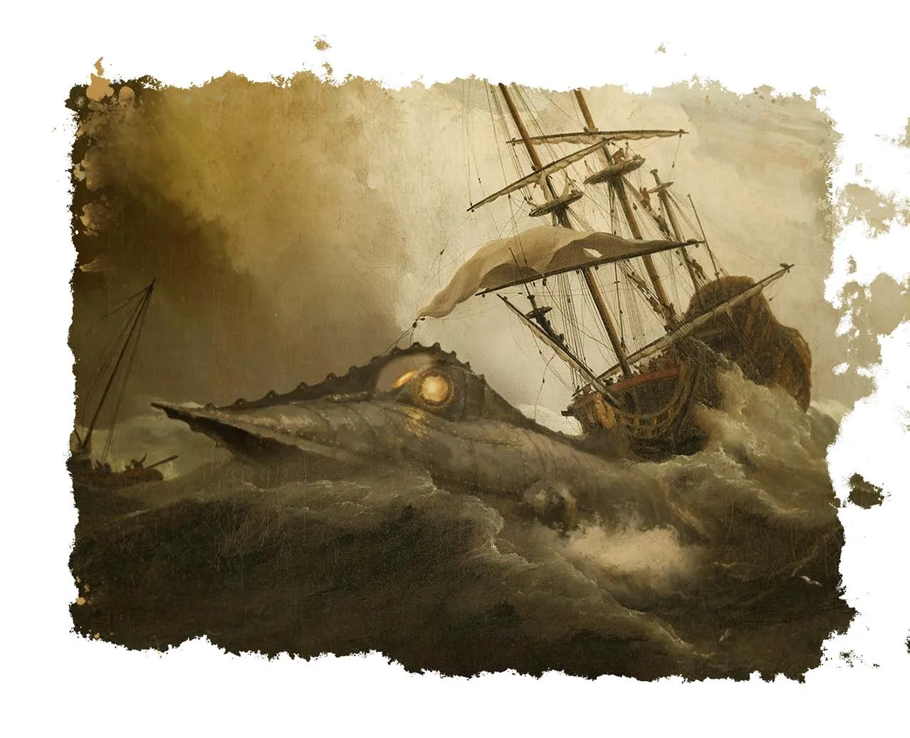

# Глава 4. Леди Немо (1894)

## Введение

Бульварные листки винят в недавней серии кораблекрушений «морское чудовище». Ужастиков нанимают, чтобы опровергнуть эту историю и, если удастся, выяснить истинную причину морских катастроф. Распутывая тайну и сами выходя в море, сыщики встречаются лицом к лицу с «чудовищем» — «Наутилусом», подводным кораблём, капитан которого — вдова пропавшего в море офицера торгового флота.

Сыщики узнают, что вдова-капитан охотится на грузовые суда судоходной компании, которую считает виновной в том, что её мужа принесли в жертву тёмным богам. Они могут даже узнать о таинственной покровительнице, оплатившей постройку этой механической угрозы. Нападение глубоководных на «Наутилус» не даёт продолжить расследование, но сводит вдову-капитана с её мужем — якобы погибшим, а на деле превратившимся, — пока сыщики пытаются спасти свои жизни.

## Предыстория

Томас Немо был капитаном грузового судна, ходившего под флагом Судоходной компании Марша. Когда он слишком глубоко копнул оккультные обряды, которые практиковал основатель компании Обед Марш, капитан, по всей видимости, пропал в море. Его вдова, Саанви Немо, считает компанию Марша виновной в убийстве мужа. Она убедилась, что компания принесла его в жертву, чтобы умилостивить тёмных богов. Она не знает, что муж на самом деле вернулся в море, к своей истинной семье, пройдя превращение в глубоководного.

Поклявшись отомстить Судоходной компании Марша, Саанви Немо — сама по себе гениальный инженер — обнаружила, что тайных покровителей, готовых оплатить постройку судна для её возмездия, хоть отбавляй. Подводный корабль она назвала «Наутилусом» и отправилась в разрушительное плавание. К началу сценария леди Немо потопила четыре грузовых судна Судоходной компании Марша.
