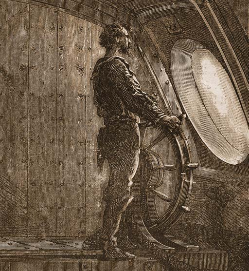

Выжившие после нападений, подобранные в море, описывают существо, которое поднимается из волн и таранит их суда, проламывая корпуса и пуская судно ко дну. Газеты раздули историю «морского чудовища» ещё сильнее, и судоходные круги охватила паника, а Адмиралтейство тем временем обсуждает возможность военного конвоя.

В **акте I** сыщики оказываются втянуты в дело, когда их нанимают страховые оценщики «Скарлетт и Мур» — якобы независимо, по поручению своих акционеров, а на деле по найму Судоходной компании Марша, чтобы положить конец слухам о морском чудовище. Первые же изыскания сыщиков показывают, что все потопленные суда принадлежали одной компании с безупречной репутацией — если не считать исчезновения талантливого капитана по имени Томас Немо три года назад.

**Акт II** начинается с того, что сыщики получают места на борту одного из грузовых судов Судоходной компании Марша. Затем «Наутилус» атакует и топит судно. Сыщиков спасает леди Немо. От неё они узнают больше о трагических обстоятельствах, которыми, по её мнению, оправдан её поход мести.

Сценарий завершается в **акте III**: на сам «Наутилус» нападают глубоководные. Твари врываются на корабль, и сыщиков затягивает в отчаянную битву за выживание. В схватке сыщики встречаются лицом к лицу с превратившимся капитаном Немо. Им предстоит решить, говорить ли об этом леди Немо и как, и спасать ли вдову-капитана, одновременно пытаясь спастись самим.

> **Хронология**
>
> - **Ноябрь 1891 года:** Томас Немо исчезает в волнах; его считают погибшим.
> - **Июль 1891 года:** убеждённая, что в смерти мужа виновна Судоходная компания Марша, леди Немо клянётся отомстить и начинает работу, которая завершится постройкой «Наутилуса».
> - **Январь 1894 года:** «Наутилус» спускается на воду в тайной бухте близ залива Бантри, Ирландия.
> - **5 мая 1894 года:** «Наутилус» топит грузовое судно Судоходной компании Марша «Дагон». Выжившие рассказывают о напавшем на них морском чудовище.
> - **17 июня 1894 года:** «Наутилус» топит грузовое судно Судоходной компании Марша «Иннсмут». Бульварные листки создают славу «Чудовищу Атлантики».
> - **2 июля 1894 года:** «Наутилус» топит грузовое судно Судоходной компании Марша «Гидра». Грузовые суда начинают менять курс, обходя середину Атлантики.
> - **10 августа 1894 года:** «Наутилус» топит грузовое судно Судоходной компании Марша «Новая Англия». Судоходные круги в панике, трансатлантическая торговля во многом полностью встаёт.
> - **1 сентября 1894 года:** с Книжным клубом связываются страховые оценщики «Скарлетт и Мур».

*Прим. перев.: в хронологии клятва мести (июль 1891 года) стоит раньше исчезновения мужа (ноябрь 1891 года), хотя по смыслу следует за ним — вероятно, имелся в виду июль 1892 года. Даты оставлены как в оригинале.*

## Связь с кампанией

Множество покровителей, тайно давших деньги на дело леди Немо, — не такая неожиданность, как может показаться на первый взгляд, ведь её первая и главная покровительница — сама Графиня. Графиня надеется распалить в леди Немо жажду мести и руками Немо и её «Наутилуса» избавиться от сверхъестественного соперника — судоходного дела Обеда Марша, — перерезав тем самым торговую артерию Британской империи.

Отсюда следует и другое: если сыщики сумеют помочь Маршам, то, готовясь к последней схватке с Графиней (см. **главу 5**), они могут обратиться к сверхъестественным возможностям Обеда Марша.
